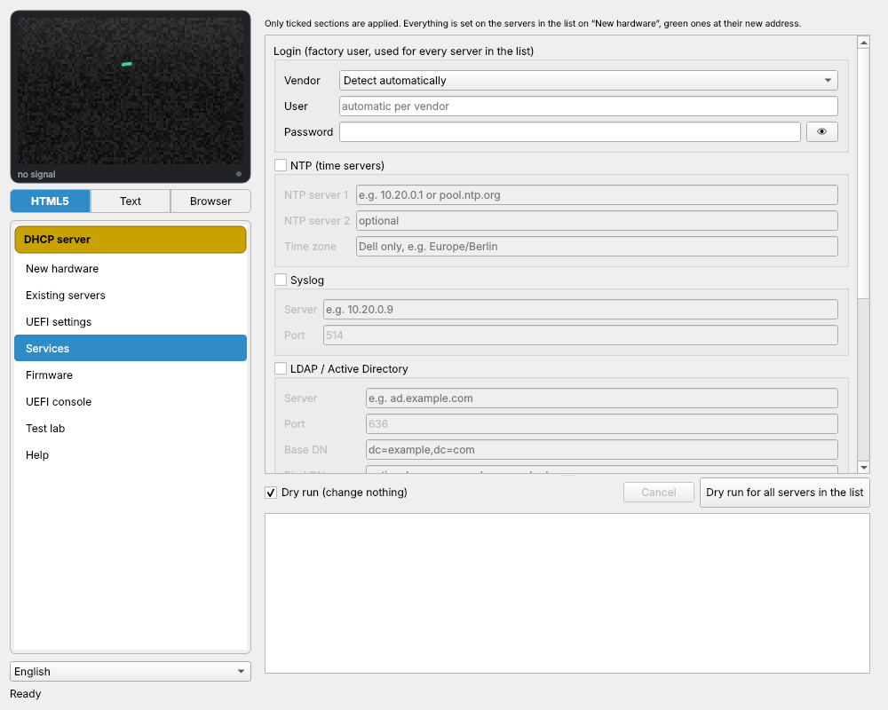

<h1>&nbsp; BMC-Steward</h1>

*English version: [README.md](README.md)*

Der BMC-Steward ist ein kleines Desktop-Tool für die Erstkonfiguration von Server-BMCs. Er bedient jeden
Server der Reihe nach: Er legt einen neuen Administrator an, setzt den Hostnamen und stellt den BMC von
der Werks- bzw. DHCP-Adresse auf eine feste Adresse um.

Unterstützt werden **Dell iDRAC**, **HPE iLO**, **Supermicro** und **Lenovo XCC** über Redfish. Ältere
HPE-Server mit **iLO 3 und iLO 4** laufen über die XML-Schnittstelle RIBCL, ältere Dell-Server mit
**iDRAC7/8** über Redfish (ab Firmware 2.50.50.50).


<details>
<summary>Screenshots aller Reiter</summary>

| | |
|---|---|
| **1 · DHCP-Server** | **2 · Server konfigurieren** (oben) |
|  | |
| **2b · Bestandsserver** (Verbindungstest) | **3 · UEFI-Einstellungen** |
|  |  |
| **4 · Dienste** | **5 · UEFI-Konsole** |
|  |  |
| **6 · Hilfe** | |
|  | |

</details>

## Was BMC-Steward kann

Alles ist in Reiter gegliedert; man arbeitet sie der Reihe nach ab oder nutzt nur, was man braucht.

| Reiter | Funktion |
|---|---|
| **1 · DHCP-Server** | Vergibt in einem getrennten Staging-Netz Adressen an frische BMCs, damit das Tool sie überhaupt erreicht. Unter Linux über dnsmasq, unter Windows eingebaut. Gefundene Geräte wandern per Klick in die Serverliste. |
| **2 · Server konfigurieren** | Das Kernstück: legt den neuen Administrator an, setzt den Hostnamen und stellt den BMC auf eine feste IP (Adresse, Subnetzmaske, Gateway) um. Server lassen sich nacheinander abarbeiten; fertige Zeilen werden grün und beim nächsten Lauf übersprungen. |
| **↳ Handy-Scanner** | Öffnet aus Reiter 2 eine kameragestützte Eingabe: Das Handy (im selben Netz oder per USB-Tethering/Hotspot verbunden) scannt Barcode oder Text (OCR) vom Geräteaufkleber, der Wert landet direkt im Passwortfeld. Es wird kein Foto auf dem Handy gespeichert, die Verbindung läuft verschlüsselt über einen geheimen Link. |
| **2b · Bestandsserver** | Für bereits konfigurierte BMCs: Verbindung nur lesend testen (Port, Verschlüsselung, Hersteller, Anmeldung, Modell, Firmware, Administratorrechte). Ein Anmeldeversuch pro Gerät, damit kein Konto gesperrt wird. Erfolgreiche Server gehen in die Reiter 2–4 über. |
| **3 · UEFI-Einstellungen** | Liest die tatsächlich vorhandenen UEFI/BIOS-Attribute von einem Referenzgerät und setzt gewünschte Werte auf allen Servern der Liste. Passwort-, TPM- und Löschattribute sind gesperrt. |
| **4 · Dienste** | Richtet herstellerübergreifend Verwaltungsdienste ein: NTP, Syslog, LDAP/AD mit Gruppen-zu-Rollen-Zuordnung und – experimentell – HTTPS-Zertifikat-Import. |
| **5 · Firmware** | Firmware-Updates über den Redfish-UpdateService: liest das Firmware-Inventar eines Referenzgeräts und spielt dann eine lokale Datei (Multipart-/HTTP-Push) oder eine Datei von einer URL (SimpleUpdate) auf alle Server der Liste – mit Live-Fortschritt und Verifikation. Trockenlauf ist Vorgabe; scharfe Läufe verlangen das Eintippen der Serverzahl. |
| **6 · UEFI-Konsole** | Zeigt das UEFI/BIOS eines Servers über den BMC – als eingebettete HTML5-Konsole, Textkonsole (SOL/SSH) oder im Standardbrowser. |
| **Testlabor** | Stellt eine Flotte virtueller Dell/HPE/Lenovo/Supermicro-BMCs zusammen (`tools/vbmc/`) – je Server Firmware-Generation, Werks-Login, Werks-IP oder DHCP, Modell/Seriennummer, belegter Dell-Slot. Drei Netze: Loopback (ohne Root), **Rechenzentrum** (virtueller Staging-Switch, DHCP aus Reiter 1) und **Router** (die Server hängen im echten LAN und erscheinen im Router). Szenarien lassen sich speichern und genau so wieder laden. |
| **7 · Hilfe** | Erklärt jeden Schritt und die Besonderheiten je Hersteller, in der gewählten Sprache. |

Dazu kommt:

- **Trockenlauf** zeigt jeden Aufruf, ohne etwas zu ändern (voreingestellt).
- **Profile** merken sich wiederkehrende Einstellungen (nie Passwörter, nie die Serverliste).
- **CSV-Import/-Export** der Serverliste, auch direkt aus einem Excel-Export.
- **Mehrsprachig:** Deutsch, Englisch, Französisch, Schweizerdeutsch.
- **Virtuelle Testflotte** (`tools/vbmc/`): virtuelle BMCs aller vier Hersteller – Redfish mit echtem Adresswechsel, dazu echtes SSH und IPMI-SOL für die Konsole. Steuerbar aus dem Testlabor-Reiter oder eigenständig über die Kommandozeile.
- **Modular aufgebaut** (Paket `bmc_steward/`); entwickelt unter Linux, läuft aus dem Quellcode auch unter Windows (die fertige .exe ist archiviert und wird nicht mehr gepflegt).

## Schutz vor Fehlbedienung

- Der Trockenlauf ist voreingestellt; ein scharfer Lauf zeigt vorher, was passiert, und „Abbrechen“ ist
  vorausgewählt
- Fehlende Einträge sind gelb markiert, fehlerhafte rot, fertige grün
- Doppelte oder schon vergebene IP-Adressen werden abgelehnt, bevor etwas geändert wird
- Ein belegter Dell-User-Slot wird nie überschrieben
- Der DHCP-Server startet nicht in einem Netz, das nach Produktivnetz aussieht (Standardroute, per DHCP
  bezogene Adresse, öffentliche Adresse, ein anderer DHCP-Server antwortet)
- UEFI-Attribute für Passwörter, TPM und Löschfunktionen sind gesperrt
- Passwörter bleiben im Arbeitsspeicher, solange man sie nicht ausdrücklich speichert

## Voraussetzungen

- Python 3.9 oder neuer
- PyQt6
- Nur Linux: `dnsmasq` und polkit (`pkexec`) für den DHCP-Server
- Optional für die UEFI-Konsole: PyQt6-WebEngine (eingebettete Konsole), `pyte` + `paramiko` + `pyghmi` (Textkonsole, Linux und Windows)

## Installieren und starten

Voraussetzung ist Python 3.9 oder neuer. Die Oberfläche braucht PyQt6; der DHCP-Server und die
optionalen Teile (Handy-Scanner, UEFI-Konsole) haben eigene Zusatzprogramme.

### Arch Linux / CachyOS

```bash
# Grundinstallation
sudo pacman -S python-pyqt6 dnsmasq git

# Code holen und starten
git clone https://github.com/daklicker-code/bmc-steward.git
cd bmc-steward
python bmc-steward.py
```

Optionale Bestandteile:

```bash
# Handy-Scanner (Barcode + Texterkennung + QR-Code)
sudo pacman -S zbar tesseract tesseract-data-eng qrencode

# UEFI-Konsole: eingebettete Web-Konsole und Textkonsole (SOL/SSH)
sudo pacman -S python-pyqt6-webengine
pip install --break-system-packages pyte paramiko pyghmi
```

Bei aktiver Firewall (ufw) für den DHCP-Server UDP 67 und für den Handy-Scanner Port 8443 freigeben:

```bash
sudo ufw allow 67/udp
sudo ufw allow 8443/tcp
```

### Windows

> **Hinweis:** Die fertige Windows-**.exe** und ihr Build sind **archiviert und werden nicht mehr
> gepflegt** (siehe [`archive/windows-build/`](archive/windows-build/)). BMC-Steward läuft unter
> Windows weiter **aus dem Quellcode** — der Code ist plattformübergreifend — entwickelt und getestet
> wird aber unter Linux.

**Aus dem Quellcode:**

1. **Python installieren** von [python.org](https://www.python.org/downloads/) (Version 3.9 oder neuer),
   beim Setup **„Add python.exe to PATH“** ankreuzen.
2. **PyQt6 installieren** in der Eingabeaufforderung:
   ```powershell
   pip install PyQt6
   ```
3. **Code holen:** entweder mit Git
   ```powershell
   git clone https://github.com/daklicker-code/bmc-steward.git
   ```
   oder auf GitHub über **Code → Download ZIP** und entpacken.
4. **Starten** im Projektordner:
   ```powershell
   python bmc-steward.py
   ```

Der DHCP-Server ist unter Windows eingebaut (kein dnsmasq nötig) — beim Start die Firewall-Abfrage
zulassen. Der Handy-Scanner braucht zusätzlich `openssl`, `zbar`, `tesseract` und `qrencode` im PATH,
unter Windows von Hand zu installieren. Die eingebettete UEFI-Konsole braucht QtWebEngine, die
**Text**konsole (SOL/SSH) braucht `pyte`, `paramiko` und `pyghmi`; mit
`pip install PyQt6-WebEngine pyte paramiko pyghmi` nachinstallieren.

### Debian / Ubuntu

```bash
sudo apt install python3-pyqt6 dnsmasq git
git clone https://github.com/daklicker-code/bmc-steward.git
cd bmc-steward
python3 bmc-steward.py
```

## Bedienung

1. Den eigenen Rechner und die BMC-Ports der neuen Server an einen **getrennten Staging-Switch** hängen.
   Der Netzwerkkarte eine feste Adresse ohne Gateway geben, z. B. `192.168.0.1/24`.
2. Reiter 1: DHCP-Server starten. Die BMCs holen sich eine Adresse und erscheinen in der Liste. Von dort
   in die Serverliste übernehmen.
3. Reiter 2: Werks-Login, neuen Administrator und je Server neue IP, Subnetzmaske, Gateway und Hostname
   eintragen.
4. Trockenlauf starten und das Protokoll lesen.
5. Haken bei „Trockenlauf“ entfernen, scharf starten und bestätigen.

Die eingebaute Hilfe (Reiter 6) erklärt jeden Schritt und die Unterschiede zwischen den Herstellern.

## CSV-Format

```
# aktuelle_ip,passwort,neue_ip,subnetzmaske,gateway,hostname,fertig
192.168.0.101,,10.20.0.11,255.255.255.0,10.20.0.1,srv-idrac-01,
```

Die Passwort-Spalte darf fehlen. Semikolons gehen auch, ein Excel-Export lässt sich also direkt laden.

## Teststand

| Hersteller | Ausgelegt auf | Stand |
|---|---|---|
| Dell | iDRAC9 (14. bis 16. Generation) | erste Zielplattform (R6625) |
| Dell | iDRAC7/8 (12./13. Generation), ab Firmware 2.50.50.50 | nur gegen simulierte BMCs geprüft |
| HPE | iLO 5 und 6 | nur gegen simulierte BMCs geprüft |
| HPE | iLO 3 (G7) und iLO 4 (Gen8/Gen9), über RIBCL | nur gegen simulierte BMCs geprüft |
| Supermicro | X12/X13 | nur gegen simulierte BMCs geprüft |
| Lenovo | XCC2/XCC3 | nur gegen simulierte BMCs geprüft |

Auch die UEFI-Einstellungen, die Verwaltungsdienste (Reiter 4) und der Windows-DHCP-Server sind bisher
nur gegen Simulationen geprüft. Abdeckung der Dienste: NTP bei allen vier Herstellern; Syslog nur bei
Dell und HPE (bei Supermicro/Lenovo übersprungen); LDAP mit Gruppen-Zuordnung bei allen vier; der
HTTPS-Zertifikat-Import ist experimentell und je Hersteller verschieden (bei HPE muss der Schlüssel aus
einer auf dem iLO erzeugten CSR stammen). Für iLO 3/4 gibt es die Dienste nicht.

Nicht unterstützt: iDRAC6, iLO 2 und älter sowie iDRAC7/8 mit Firmware vor 2.50.50.50 (das Tool erkennt
das, meldet es und ändert nichts). iLO 3 kann nur TLS 1.0/1.1; das Tool schaltet für solche Geräte von
selbst auf die alte Verschlüsselung um und vermerkt es im Protokoll.
**Vor einem großen Rollout immer zuerst ein einzelnes Gerät konfigurieren.**

## Sicherheitshinweise

- Das Tool nur in einem getrennten Staging-Netz verwenden.
- BMCs haben ab Werk selbstsignierte Zertifikate, TLS-Zertifikate werden deshalb nicht geprüft.
- Eine gespeicherte Liste enthält Passwörter nur auf ausdrücklichen Wunsch, dann im Klartext. So eine Datei
  nach dem Rollout löschen.

## Lizenz

MIT, siehe [LICENSE](LICENSE). Die Software kommt ohne Gewähr; die Nutzung erfolgt auf eigenes Risiko.

## Autor

Björn Franzke
