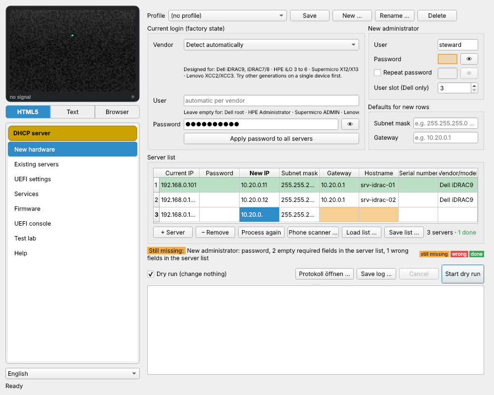
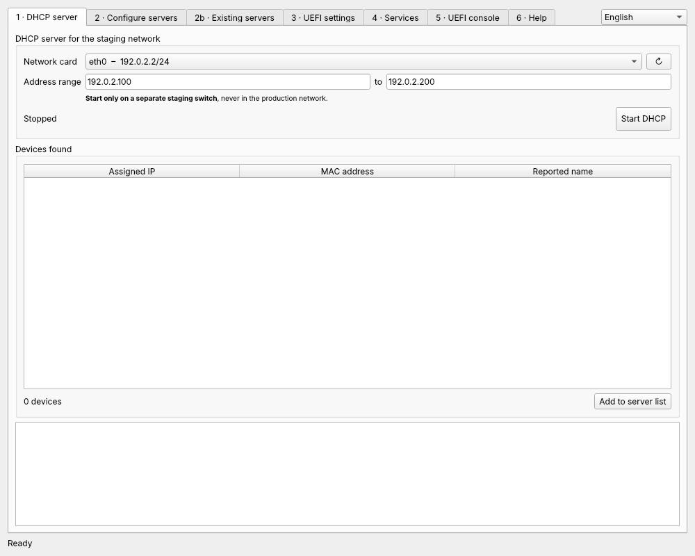
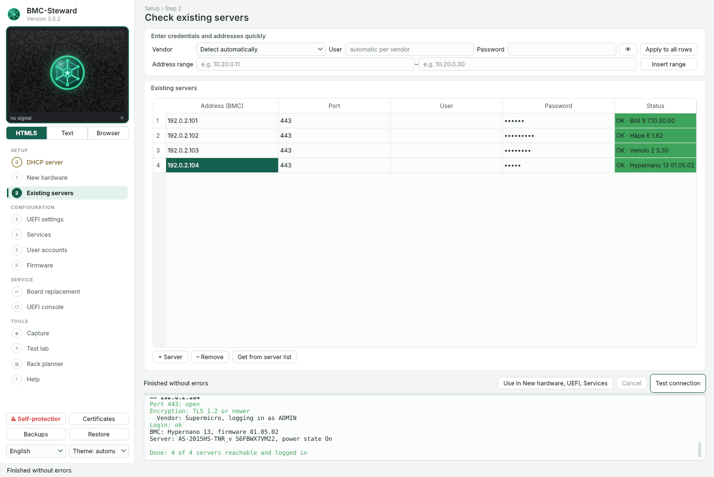
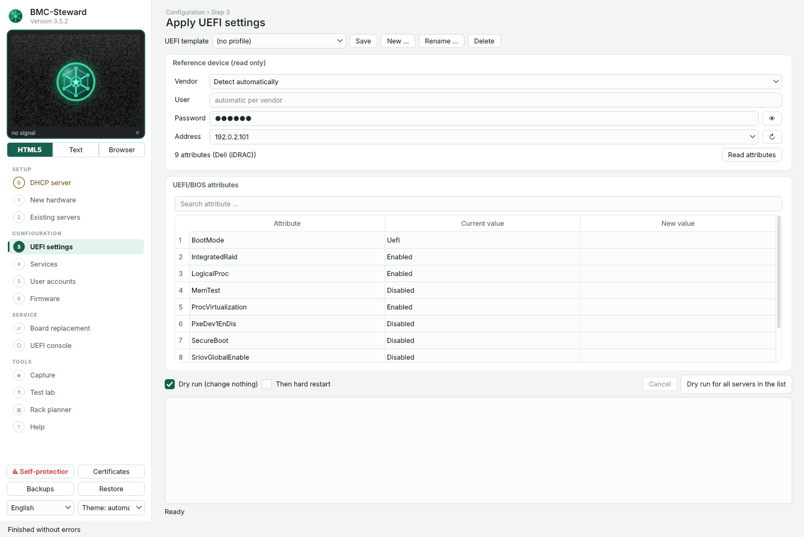
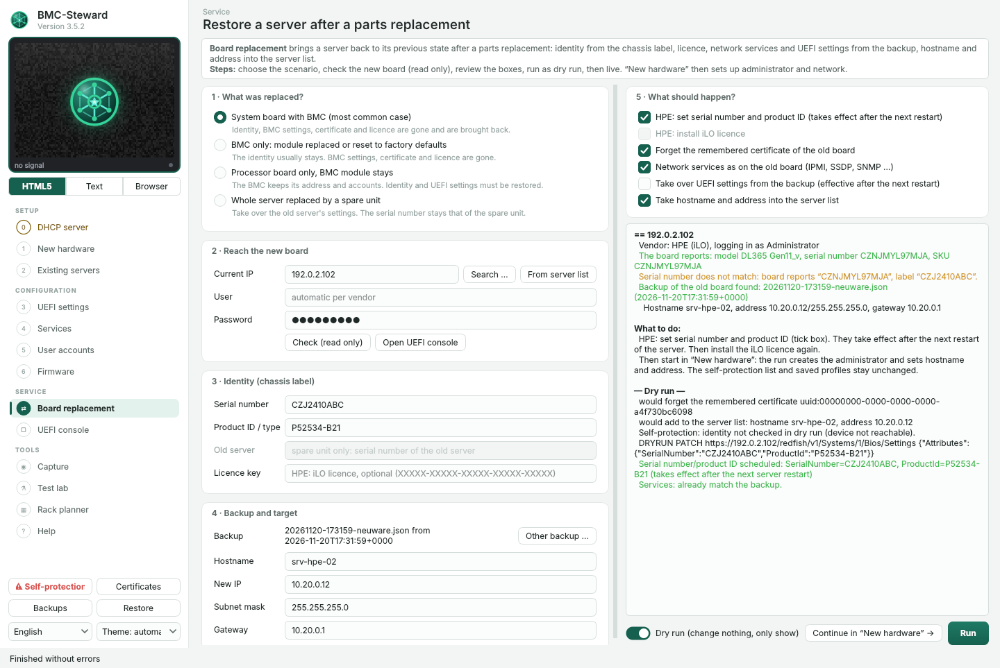
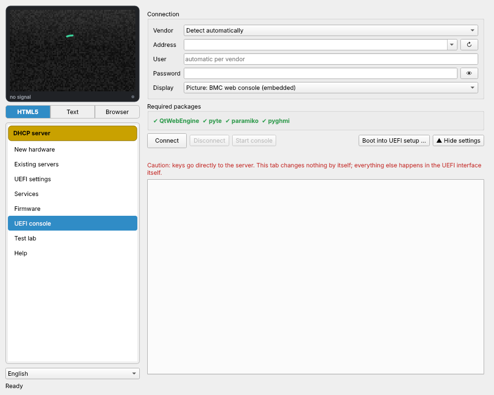
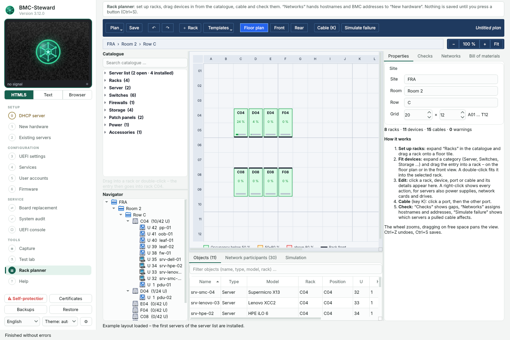
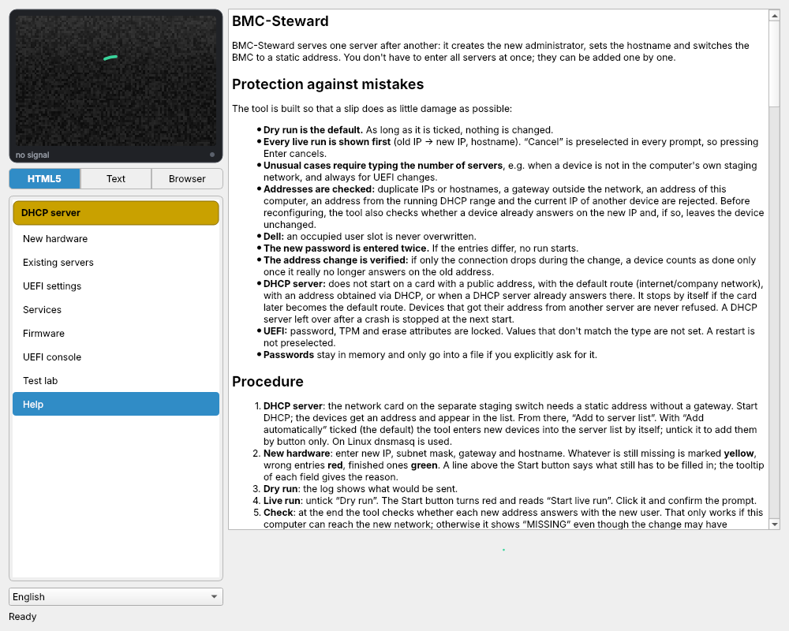

<h1>&nbsp;BMC-Steward</h1>

*English version: [README.md](README.md)*

**BMC-Steward richtet Server-Managementcontroller (BMCs) ein – von der ersten DHCP-Adresse bis zum fertigen,
gehärteten Server.** Er arbeitet eine Serverliste der Reihe nach ab: legt den neuen Administrator an, setzt
Hostname und feste Adresse, sperrt das Werkskonto und kümmert sich danach für die ganze Liste um
UEFI-Einstellungen, Dienste, Benutzerkonten, Firmware und den Mainboard-Tausch.

Unterstützt: **Dell iDRAC** (iDRAC7/8 ab Firmware 2.50.50.50, iDRAC9), **HPE iLO** (iLO 5/6 über Redfish,
iLO 3/4 über RIBCL), **Supermicro** und **Lenovo XCC** – gemischte Listen sind kein Problem, der Hersteller wird je
Gerät erkannt.



- **Sicher voreingestellt:** Jede Seite startet im Trockenlauf, scharfe Läufe fragen vorher nach, und der Rechner,
  auf dem das Tool läuft, wird nie neu gestartet oder geflasht.
- **Nichts wird ungefragt gespeichert:** Passwörter bleiben im Arbeitsspeicher; Datei oder Schlüsselbund nur auf
  Wunsch.
- **Erst nur lesend prüfen:** Verbindungstest, Herstellererkennung, Seriennummern und Aufnahme ändern nie etwas am
  Gerät.
- **Vier Sprachen:** Deutsch, Englisch, Französisch, Schweizerdeutsch. Helles und dunkles Design.

<details>
<summary><b>Screenshots aller Seiten</b> (englische Oberfläche)</summary>

| | |
|---|---|
| **DHCP-Server** | **Bestandsserver** (Verbindungstest) |
|  |  |
| **UEFI-Einstellungen** | **Dienste** |
|  |  |
| **Mainboard-Tausch** | **UEFI-Konsole** |
|  |  |
| **Aufbauplaner** (Plugin) | **Hilfe** |
|  |  |

</details>

## Die Seiten

Das Menü links folgt der Reihenfolge der Arbeit. Jede Seite beginnt mit einer kurzen Erklärung, die Hauptaktion ist
der grüne Knopf.

### Einrichtung – Server in die Liste bringen

| Seite | Funktion |
|---|---|
| **0 · DHCP-Server** | Vergibt frischen BMCs an einem getrennten Staging-Switch eine Adresse (unter Linux dnsmasq, unter Windows eingebaut) und startet nicht in einem Netz, das nach Produktivnetz aussieht. Gefundene Geräte kommen per Klick oder automatisch in die Serverliste. Auf Wunsch öffnet sich jeder neu angeschlossene Server in der UEFI-Konsole, sobald seine Weboberfläche antwortet. |
| **1 · Neuware** | Das Kernstück: legt je Server den neuen Administrator an, setzt Hostname und feste IP, meldet sich zur Kontrolle unter der neuen Adresse an und sperrt das Werkskonto. Fertige Zeilen werden grün und beim nächsten Lauf übersprungen. Mit **Handy-Scanner** (Passwort per Kamera vom Aufkleber) und **Server suchen** (BMCs mit unbekannter Adresse, nur lesend). **Übergabe** erstellt ein Übergabeprotokoll der Serverliste als PDF, Excel oder CSV (ohne Passwörter), auch zum Öffnen oder per E-Mail. |
| **2 · Bestandsserver** | Verbindungstest für bereits konfigurierte BMCs, nur lesend: Port, Verschlüsselung, Hersteller, Anmeldung, Modell, Firmware, Administratorrechte. Ein Anmeldeversuch je Gerät, damit kein Konto gesperrt wird. Erfolgreiche Server gehen an die übrigen Seiten. |

### Konfiguration – für die Server der Liste

| Seite | Funktion |
|---|---|
| **3 · UEFI-Einstellungen** | Liest die tatsächlich vorhandenen Attribute von einem Referenzgerät und setzt die gewählten Werte auf allen Servern. Passwort-, TPM- und Lösch-Attribute sind gesperrt. |
| **4 · Dienste** | NTP, Syslog, LDAP/Active Directory mit Gruppen-zu-Rollen-Zuordnung, DNS und **Härtung** (IPMI über LAN, SSDP, SNMP aus; Kontosperre; Sitzungs-Zeitlimit). Eine Fähigkeitsmatrix zeigt, was welcher Hersteller kann. |
| **5 · Benutzerkonten** | Konten eines Servers: anzeigen, anlegen, löschen, Rolle ändern, Passwort und SSH-Keys setzen. **Passwort-Rotation** für die ganze Serverliste, auf Knopfdruck oder nach Plan. |
| **6 · Firmware** | Updates über den Redfish-UpdateService aus einer Datei oder von einer URL, mit SHA-256-Prüfung, Live-Fortschritt und Kontrolle. Ein scharfer Lauf verlangt das Eintippen der Serverzahl. |

### Service – einzelne Server

| Seite | Funktion |
|---|---|
| **Mainboard-Tausch** | Bringt einen Server nach einem Teiletausch in fünf Schritten wieder auf den alten Stand. Szenarien: Systemplatine mit BMC · nur BMC (getauscht oder auf Werkseinstellungen) · nur Prozessorplatine · ganzer Server durch Ersatzgerät. „Prüfen“ zeigt, was das Board meldet (Seriennummer, Typ); Werte vom Aufkleber nur bei Abweichung eintragen. **HPE iLO 5/6:** Seriennummer und Produkt-ID vom Gehäuse-Aufkleber und die iLO-Lizenz werden neu gesetzt. Netzwerkdienste und UEFI-Einstellungen kommen aus der Sicherung des alten Boards, Hostname und Adresse gehen an „Neuware“. Ein Ersatzgerät behält seine Seriennummer. Hinweise je Hersteller (Dell Easy Restore, Lenovo OneCLI/FoD, Supermicro SUM, HPE RBSU). |
| **Systemaudit** | Audit-Blatt eines Servers als PDF (A4 quer): liest nur lesend Hersteller, Modell, Seriennummer sowie Arbeitsspeicher, Prozessoren, Netzteile und Datenträger mit Part- und Seriennummern. Dazu Checkliste, Bemerkung und Unterschriftsfeld; alles von Hand änderbar. Mehrere Server auf einmal als ein PDF (je Server ein Blatt); Mitarbeiter einmal anlegen (optional E-Mail, Telefon, Adresse, Zusatz) und dann nur noch auswählen. Versand per E-Mail (SMTP oder eigenes Mailprogramm). Als PDF öffnen, drucken, Inventar als Excel/CSV, Audit als JSON, automatische Ablage jedes PDFs, QR-Code mit der Seriennummer auf dem Blatt. |
| **Einstellungen (⚙)** | Schriftart und -größe, Design, Konsolen-Reiter im Monitor, Protokoll (Stufe, fortlaufende Protokolldatei, Aufbewahrung), Systemaudit (Auslesen bei Auswahl, PDF-Ordner, Mail-Vorlagen), E-Mail-Versand (SMTP), Experteneinstellungen (Kontroll-Wartezeit, Zeitlimit für BMC-Anfragen) und Freigabe der Plugins. Server aus „Neuware“ und „Bestandsserver“ in einer Auswahlliste, auch direkt per „Systemaudit …“ aus „Neuware“, „Bestandsserver“ und „UEFI-Konsole“. |
| **UEFI-Konsole** | UEFI/BIOS eines Servers über den BMC: eingebettete HTML5-Konsole, Textkonsole (SOL/SSH) oder Standardbrowser. Bildschirmtastatur mit Setup-Tasten je Hersteller, „Text tippen“, Bildschirmfoto, Vollbild und automatisches Neuverbinden. „Ins UEFI-Setup starten“ startet den Server nach der Eigenschutz-Prüfung direkt ins Setup. |

### Werkzeuge

| Seite | Funktion |
|---|---|
| **Aufnahme** | Liest den Redfish-Baum eines echten Geräts streng lesend und speichert ihn geschwärzt (keine Seriennummern, Adressen, Zertifikate oder Schlüssel). Zwei Aufnahmen lassen sich vergleichen, z. B. vor und nach einem Firmware-Update. |
| **Testlabor** | Virtuelle Dell-, HPE-, Lenovo- und Supermicro-BMCs (`tools/vbmc/`) zum Üben ohne Hardware: Loopback, virtueller Staging-Switch oder echtes LAN. |
| **Hilfe** | Jeder Schritt und die Besonderheiten je Hersteller, mit Suche und Inhaltsverzeichnis. |

### Rund um die Seiten

- **Monitor (links oben):** zeigt die verbundene Server-Konsole als Live-Miniatur; ein Klick öffnet sie in voller
  Größe. Sind mehrere Sitzungen offen (UEFI-Konsole, Konsolen von Plugins), wechselt man über die Reiter am oberen Rand –
  bis zu 10, einstellbar unter ⚙ → Darstellung. Der Schalter darunter wählt die Konsolenart: **HTML5**, **Text** (SOL/SSH) oder **Browser**.
- **Links unten:** Eigenschutz-Liste, gemerkte Zertifikate, Sicherungen, Wiederherstellen, Sprache und Design.
- **Profile** merken sich wiederkehrende Einstellungen (nie Passwörter, nie die Serverliste). **CSV-Import/-Export**
  der Serverliste, auch direkt aus Excel.
- **Tooltips** an jedem Feld erklären, was es tut und worauf zu achten ist.
- Fehlt ein optionales Paket, zeigt die betroffene Seite den passenden Installationsbefehl.
- **Plugins** erweitern das Tool um eigene Seiten und Abläufe: ein Ordner mit `plugin.json` und `plugin.py` unter
  `<Datenordner>/plugins/`, einzeln freizugeben unter ⚙ → „Plugins“; danach bietet das Tool einen Neustart an. Beispiel: [`docs/plugin-beispiel/`](docs/plugin-beispiel/).
  Plugins können eigene Konsolen als Reiter im Monitor zeigen (`api.add_console`, Terminal-Widget über `api.terminal`).
  Fertiges Plugin **Portscan** ([`docs/plugin-portscan/`](docs/plugin-portscan/)): prüft offene TCP-Ports (Vorlagen für
  BMC- und Server-Dienste, optional IPMI über UDP 623 und Banner) auf Adressen, Netzen oder der Serverliste, mit CSV-Export.
  Nur Verbindungsaufbau, keine Anmeldung.
  Mitgeliefertes Plugin **Aufbauplaner** ([`bmc_steward/plugins_mitgeliefert/aufbauplaner/`](bmc_steward/plugins_mitgeliefert/aufbauplaner/)):
  lädt beim Start von selbst (abschaltbar unter ⚙ → „Plugins“) und steht im Menü unter „Plugins“. Plant Racks,
  Verkabelung und Adressen, prüft Redundanz und PDU-Last, erstellt eine Stückliste und übergibt Hostnamen und
  BMC-Adressen an „Neuware“ oder die Server ans Testlabor. Server lassen sich mit Netzteilen, Netzwerkkarten,
  Transceivern (SFP+, SFP28, QSFP28, FC) und Laufwerken bestücken; Grundriss mit Bodenplatten-Koordinaten,
  Ausfall-Simulation, Rückgängig. Die Hilfe steht im Menü „Plan“ der Seite.

## Schutz vor Fehlbedienung

- Der Trockenlauf ist voreingestellt; ein scharfer Lauf zeigt vorher, was passiert, und „Abbrechen“ ist
  vorausgewählt
- Fehlende Einträge sind gelb markiert, fehlerhafte rot, fertige grün
- Doppelte oder schon vergebene IP-Adressen werden abgelehnt, bevor etwas geändert wird
- Ein belegter Dell-User-Slot wird nie überschrieben
- Der DHCP-Server startet nicht in einem Netz, das nach Produktivnetz aussieht (Standardroute, per DHCP
  bezogene Adresse, öffentliche Adresse, ein anderer DHCP-Server antwortet)
- UEFI-Attribute für Passwörter, TPM und Löschfunktionen sind gesperrt
- Passwörter bleiben im Arbeitsspeicher, solange man sie nicht ausdrücklich speichert (auch nach einer Passwort-Rotation: Schlüsselbund nur mit Haken, Datei nur auf Nachfrage)
- Sicherungen auf der Platte enthalten keine Geheimnisse (Passwörter, SNMP-Community, Token werden geleert)
- **Zertifikats-Vertrauen:** Das Zertifikat jedes BMC wird beim ersten Kontakt gemerkt; zeigt dasselbe Gerät
  später ein anderes, wird es gesperrt, bevor ein Passwort gesendet wird (Knopf „Zertifikate …“)
- **Anmeldung per Redfish-Session:** Das Passwort geht je Gerät einmal über die Leitung, am Ende wird abgemeldet;
  eine abgelehnte Anmeldung wird nie wiederholt (keine Kontosperre durch das Tool)
- **Sicherung vor jeder Änderung** (JSON je Gerät) und **Revisionsprotokoll** aller ändernden Aufrufe scharfer
  Läufe (Knopf „Sicherungen/Protokolle“)
- **Werkskonto wird gesperrt:** Nach erfolgreicher Kontrolle meldet sich das Tool mit dem neuen Administrator
  unter der neuen Adresse an und sperrt das Werkskonto (root, Administrator, ADMIN, USERID). Kann ein BMC Konten
  nicht abschalten, bekommt es ein nirgends gespeichertes Zufallspasswort. Abschaltbar über den Haken
  „Werkskonto danach sperren“
- **Firmware:** SHA-256-Prüfung gegen den Sollwert des Herstellers, die geprüfte Datei wird für alle Server
  verwendet; „Bei Fehler anhalten“ ist voreingestellt
- **Eigenschutz:** UEFI-Änderungen, Firmware-Updates und „Ins UEFI-Setup booten“ prüfen vorher die Identität
  des Servers. Der eigene Rechner und alle Server der Schutzliste (Knopf „Eigenschutz“ links unten) werden nie
  neu gestartet oder geflasht; ist die Identität im scharfen Lauf nicht lesbar, wird der Server übersprungen

## Voraussetzungen

- Python 3.9 oder neuer
- PyQt6
- Nur Linux: `dnsmasq` und polkit (`pkexec`) für den DHCP-Server
- Optional für die UEFI-Konsole: PyQt6-WebEngine (eingebettete Konsole), `pyte` + `paramiko` + `pyghmi` (Textkonsole, Linux und Windows)

## Installieren und starten

Voraussetzung ist Python 3.9 oder neuer. Die Oberfläche braucht PyQt6; der DHCP-Server und die
optionalen Teile (Handy-Scanner, UEFI-Konsole) haben eigene Zusatzprogramme.

### Arch Linux / CachyOS

```bash
# Grundinstallation
sudo pacman -S python-pyqt6 dnsmasq git

# Code holen und starten
git clone https://github.com/daklicker-code/bmc-steward.git
cd bmc-steward
python bmc-steward.py
```

Optionale Bestandteile:

```bash
# Handy-Scanner (Barcode + Texterkennung + QR-Code)
sudo pacman -S zbar tesseract tesseract-data-eng qrencode

# UEFI-Konsole: eingebettete Web-Konsole und Textkonsole (SOL/SSH)
sudo pacman -S python-pyqt6-webengine
pip install --break-system-packages pyte paramiko pyghmi
```

Bei aktiver Firewall (ufw) für den DHCP-Server UDP 67 und für den Handy-Scanner Port 8443 freigeben:

```bash
sudo ufw allow 67/udp
sudo ufw allow 8443/tcp
```

### Windows

> **Hinweis:** Die fertige Windows-**.exe** und ihr Build sind **archiviert und werden nicht mehr
> gepflegt** (siehe [`archive/windows-build/`](archive/windows-build/)). BMC-Steward läuft unter
> Windows weiter **aus dem Quellcode** — der Code ist plattformübergreifend — entwickelt und getestet
> wird aber unter Linux.

**Aus dem Quellcode:**

1. **Python installieren** von [python.org](https://www.python.org/downloads/) (Version 3.9 oder neuer),
   beim Setup **„Add python.exe to PATH“** ankreuzen.
2. **PyQt6 installieren** in der Eingabeaufforderung:
   ```powershell
   pip install PyQt6
   ```
3. **Code holen:** entweder mit Git
   ```powershell
   git clone https://github.com/daklicker-code/bmc-steward.git
   ```
   oder auf GitHub über **Code → Download ZIP** und entpacken.
4. **Starten** im Projektordner:
   ```powershell
   python bmc-steward.py
   ```

Der DHCP-Server ist unter Windows eingebaut (kein dnsmasq nötig) — beim Start die Firewall-Abfrage
zulassen. Der Handy-Scanner braucht zusätzlich `openssl`, `zbar`, `tesseract` und `qrencode` im PATH,
unter Windows von Hand zu installieren. Die eingebettete UEFI-Konsole braucht QtWebEngine, die
**Text**konsole (SOL/SSH) braucht `pyte`, `paramiko` und `pyghmi`; mit
`pip install PyQt6-WebEngine pyte paramiko pyghmi` nachinstallieren.

**Gepinnte Installation (optional, für den Produktivbetrieb empfohlen):** `requirements.lock` und
`requirements-optional.lock` legen jede Abhängigkeit auf eine exakte Version mit SHA-256-Hashes fest.
Installieren mit `pip install --require-hashes -r requirements.lock` (für die optionalen Teile zusätzlich
`-r requirements-optional.lock`). Die CI nutzt dieselben Dateien; CodeQL, Dependabot und eine
CycloneDX-SBOM je Versions-Tag (als Workflow-Artefakt) sind unter `.github/` eingerichtet.

### Debian / Ubuntu

```bash
sudo apt install python3-pyqt6 dnsmasq git
git clone https://github.com/daklicker-code/bmc-steward.git
cd bmc-steward
python3 bmc-steward.py
```

## Bedienung

1. Den eigenen Rechner und die BMC-Ports der neuen Server an einen **getrennten Staging-Switch** hängen.
   Der Netzwerkkarte eine feste Adresse ohne Gateway geben, z. B. `192.168.0.1/24`.
2. „DHCP-Server“: DHCP-Server starten. Die BMCs holen sich eine Adresse und erscheinen in der Liste. Von dort
   in die Serverliste übernehmen.
3. „Neuware“: Werks-Login, neuen Administrator und je Server neue IP, Subnetzmaske, Gateway und Hostname
   eintragen.
4. Trockenlauf starten und das Protokoll lesen.
5. Haken bei „Trockenlauf“ entfernen, scharf starten und bestätigen.

Die eingebaute Hilfe (Menüpunkt „Hilfe“) erklärt jeden Schritt und die Unterschiede zwischen den Herstellern.

Das **Protokoll** unter der Serverliste ist für das ganze Programm dasselbe, auch im Testlabor. Es füllt sich schon beim Start und hält jede Aktion fest (Knöpfe, Haken, Auswahl, Seitenwechsel) sowie die Meldungen der Läufe – nie Passwörter. „Info“ (Standard) zeigt Aktionen und Ergebnisse, „Debug“ zusätzlich technische Einzelheiten. Der Knopf **Protokoll** öffnet es als Textdatei im Standard-Editor.

## CSV-Format

```
# aktuelle_ip,passwort,neue_ip,subnetzmaske,gateway,hostname,fertig
192.168.0.101,,10.20.0.11,255.255.255.0,10.20.0.1,srv-idrac-01,
```

Die Passwort-Spalte darf fehlen. Semikolons gehen auch, ein Excel-Export lässt sich also direkt laden.

## Teststand

| Hersteller | Ausgelegt auf | Stand |
|---|---|---|
| Dell | iDRAC9 (14. bis 16. Generation) | erste Zielplattform (R6625) |
| Dell | iDRAC7/8 (12./13. Generation), ab Firmware 2.50.50.50 | nur gegen simulierte BMCs geprüft |
| HPE | iLO 5 und 6 | nur gegen simulierte BMCs geprüft |
| HPE | iLO 3 (G7) und iLO 4 (Gen8/Gen9), über RIBCL | nur gegen simulierte BMCs geprüft |
| Supermicro | X12/X13 | nur gegen simulierte BMCs geprüft |
| Lenovo | XCC2/XCC3 | nur gegen simulierte BMCs geprüft |

Auch die UEFI-Einstellungen, die Verwaltungsdienste („Dienste“) und der Windows-DHCP-Server sind bisher
nur gegen Simulationen geprüft. Abdeckung der Dienste: NTP bei allen vier Herstellern; Syslog nur bei
Dell und HPE (bei Supermicro/Lenovo übersprungen); LDAP mit Gruppen-Zuordnung bei allen vier; der
HTTPS-Zertifikat-Import ist experimentell und je Hersteller verschieden (bei HPE muss der Schlüssel aus
einer auf dem iLO erzeugten CSR stammen). Für iLO 3/4 gibt es die Dienste nicht.

Nicht unterstützt: iDRAC6, iLO 2 und älter sowie iDRAC7/8 mit Firmware vor 2.50.50.50 (das Tool erkennt
das, meldet es und ändert nichts). iLO 3 kann nur TLS 1.0/1.1; das Tool schaltet für solche Geräte von
selbst auf die alte Verschlüsselung um und vermerkt es im Protokoll.
**Vor einem großen Rollout immer zuerst ein einzelnes Gerät konfigurieren.**

## Betrieb in einer VM (VMware, Proxmox, Hyper-V)

- **Eigenschutz einrichten:** Die VM kennt ihren Host nicht. Unter „Eigenschutz“ alle Hosts eintragen, auf
  denen die VM laufen kann (Service-Tag/Seriennummer, System-UUID oder BMC-Adresse). Solange die Liste leer
  ist, zeigt der Knopf eine rote Warnung und jede Sicherheitsabfrage weist darauf hin.
- Die VM möglichst auf einem eigenen Management-Host/-Cluster betreiben, nicht auf den Servern, die sie
  bearbeitet. Während Firmware-Läufen kein vMotion, kein Snapshot mit Arbeitsspeicher, kein Suspend.
- Netzwerk: eigene Netzwerkkarte (vmxnet3) in der Staging-/OOB-Portgruppe, kein NAT. Der DHCP-Server und die
  SSDP-Suche brauchen dasselbe L2-Segment wie die BMCs. Für fabrikneue BMCs mit fester Werks-IP eine
  zusätzliche Adresse in deren Netz vergeben.
- Für Virtual Media holt sich der BMC die Datei selbst – er muss die VM erreichen können.
- Zeit per NTP **oder** VMware-Tools-Zeitabgleich, nicht beides.
- Gespeicherte Listen mit Passwörtern landen in jedem VM-Backup: nicht speichern oder die VM verschlüsseln.

## Sicherheitshinweise

- Das Tool nur in einem getrennten Staging-Netz verwenden.
- BMCs haben ab Werk selbstsignierte Zertifikate. Statt gegen eine CA prüft das Tool deshalb nach dem Prinzip
  „beim ersten Kontakt merken“: Der SHA-256-Fingerabdruck wird je Gerät gespeichert, ein späterer Wechsel sperrt
  das Gerät, bevor ein Passwort gesendet wird. Der allererste Kontakt ist ungeschützt – deshalb nur im getrennten
  Staging-Netz arbeiten und bei Bestandsservern den Fingerabdruck einmal mit der BMC-Oberfläche vergleichen.
- Meldet sich unter einer Adresse, an der schon ein anderes Gerät gemerkt ist, ein unbekanntes Gerät mit anderem
  Zertifikat, wird es gesperrt (sonst könnte sich ein Angreifer einfach als „neues Gerät“ ausgeben). Nur bei
  „Neuware“ und „Mainboard-Tausch“ gibt es dann bloß einen Hinweis, weil sich Werks- und DHCP-Adressen dort mit neuen Geräten wiederholen.
  Nach einem Gerätetausch den alten Eintrag unter „Zertifikate“ entfernen.
- DHCP-Server und Testlabor starten Programme aus dem Tool-Ordner per `pkexec` mit Root-Rechten. Der Tool-Ordner
  sollte deshalb nur für den eigenen Benutzer schreibbar sein; wer ganz sicher gehen will, legt ihn root-eigen ab
  (z. B. unter `/opt`) und startet BMC-Steward von dort.
- Der Link des Handy-Scanners enthält einen zufälligen 128-Bit-Geheimwert und gilt nur, solange das Scanner-Fenster
  läuft.
- Arbeitsdaten (Fingerabdrücke `bmc-pins.json`, Sicherungen `sicherungen/`, Revisionsprotokoll `protokolle/`)
  liegen neben dem Tool, Rechte 0600/0700. Mit der Umgebungsvariable `BMC_STEWARD_DATA` lässt sich ein anderer
  Ordner wählen, z. B. ein verschlüsseltes Laufwerk.
- Eine gespeicherte Liste enthält Passwörter nur auf ausdrücklichen Wunsch, dann im Klartext. So eine Datei
  nach dem Rollout löschen.
- Plugins sind Python-Code mit allen Rechten des Programms. Nichts wird von selbst geladen: Jedes Plugin muss
  einzeln freigegeben werden, das Tool merkt sich dabei einen SHA-256-Fingerabdruck aller Dateien und lädt das
  Plugin nach jeder Änderung erst nach erneuter Freigabe. Unter Linux bleiben Plugins in Ordnern, die andere
  Benutzer beschreiben dürfen, gesperrt. `BMC_STEWARD_NO_PLUGINS=1` startet ohne Plugins.

## Version prüfen

Jeder Versions-Tag wird ohne persönlichen Schlüssel signiert (Sigstore „keyless“ über GitHub-Attestierungen):
Der Workflow *Signieren* erzeugt das Quellarchiv des Tags reproduzierbar (`tools/release-archive.sh`), und
GitHub bescheinigt, aus welchem Repository, Workflow und Commit es stammt. Prüfen einer heruntergeladenen oder
ausgecheckten Version (braucht `git` und eine angemeldete GitHub-CLI `gh`):

```bash
tools/verify-release.sh v3.4.1
```

Das Skript baut das Archiv aus dem Tag byte-gleich nach und lässt `gh attestation verify` die Bescheinigung
prüfen. Wurde der Tag verschoben oder der Inhalt verändert, schlägt die Prüfung fehl.

## Lizenz, Haftung und Marken

MIT, siehe [LICENSE](LICENSE). Herkunft des Codes und Lizenzen der Abhängigkeiten: [docs/HERKUNFT.md](docs/HERKUNFT.md).
BMC-Steward enthält keinen Code und keine Texte der Hersteller.

**Haftungsausschluss.** Die Software wird ohne jede Gewähr bereitgestellt. Der Autor übernimmt keine Haftung für Schäden
oder Folgen, die durch den Einsatz des Werkzeugs entstehen, und ausdrücklich auch nicht dafür, was andere damit machen
(einschließlich Konfigurationsfehlern, Datenverlust, Ausfällen, unbefugter oder rechtswidriger Nutzung). Wer das Werkzeug
einsetzt, handelt auf eigene Verantwortung, prüft vorher mit Trockenlauf und Backup und setzt es nur an Geräten ein, für die
er berechtigt ist. Soweit zwingendes Recht nichts anderes vorschreibt.

**Marken.** Dell, iDRAC, HPE, iLO, Lenovo, XClarity, Supermicro und weitere genannte Namen sind Marken ihrer jeweiligen
Inhaber und werden nur beschreibend verwendet. BMC-Steward steht in keiner Verbindung zu diesen Firmen und wird nicht von
ihnen unterstützt. Der mitgelieferte Simulator verwendet frei erfundene Namen (Böll, Häpe, Venolo, Hypernano).

## Autor

Björn Franzke
