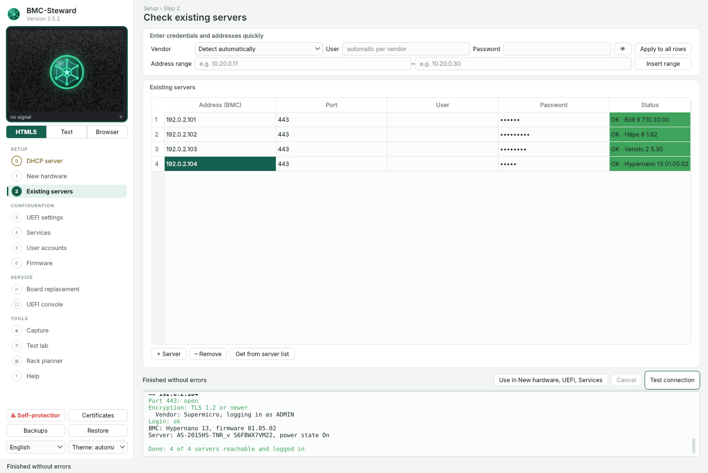
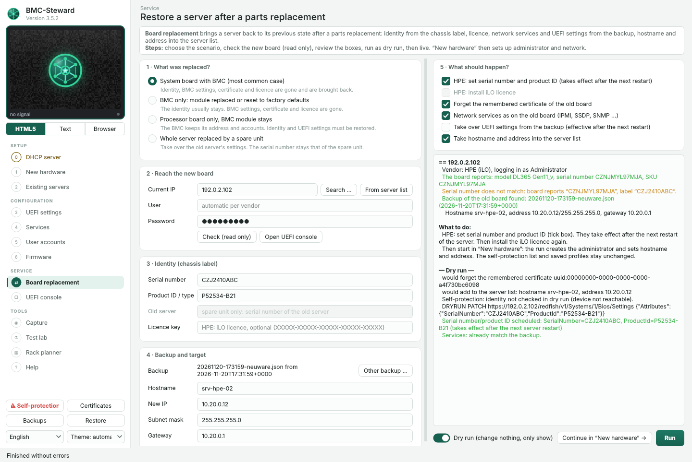
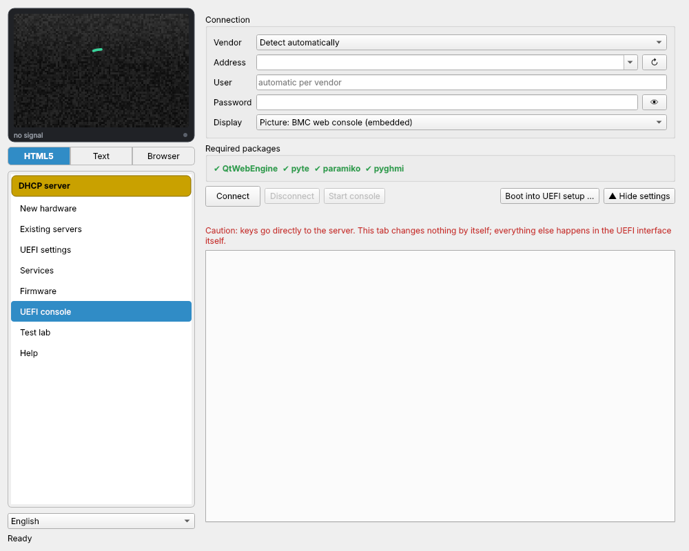

<h1>&nbsp;BMC-Steward</h1>

*Deutsche Fassung: [README.de.md](README.de.md)*

**BMC-Steward sets up server management controllers (BMCs) – from the first DHCP address to the finished,
hardened server.** It works through a list of servers one after another: creates the new administrator, sets
hostname and static address, locks the factory account, and then takes care of UEFI settings, services, user
accounts, firmware and board replacements across the whole list.

Supported: **Dell iDRAC** (iDRAC7/8 from firmware 2.50.50.50, iDRAC9), **HPE iLO** (iLO 5/6 via Redfish,
iLO 3/4 via RIBCL), **Supermicro** and **Lenovo XCC** – mixed lists are fine, the vendor is detected per device.


- **Safe by default:** every page starts in dry run, live runs ask first, and the server running the tool is
  never restarted or flashed.
- **Nothing stored unasked:** passwords stay in memory; files or the keyring only on request.
- **Read-only checks first:** connection test, vendor detection, serial numbers and capture never change a device.
- **Four languages:** German, English, French, Swiss German. Light and dark design.

<details>
<summary><b>Screenshots of all pages</b></summary>

| | |
|---|---|
| **DHCP server** | **Existing servers** (connection test) |
|  |  |
| **UEFI settings** | **Services** |
|  |  |
| **Board replacement** | **UEFI console** |
|  |  |
| **Rack planner** (plugin) | **Help** |
|  |  |

</details>

## The pages

The menu on the left follows the order of the work. Each page starts with a short explanation, the main action is
the green button.

### Setup – getting servers into the list

| Page | What it does |
|---|---|
| **0 · DHCP server** | Hands out addresses to fresh BMCs on a separate staging switch (dnsmasq on Linux, built in on Windows) and refuses to start on anything that looks like a production network. Found devices go into the server list with one click or automatically. Optionally opens every newly connected server in the UEFI console as soon as its web interface answers. |
| **1 · New hardware** | The core: per server it creates the new administrator, sets hostname and static IP, logs in again at the new address to verify and locks the factory account. Finished rows turn green and are skipped next time. With **phone scanner** (password off the label by camera) and **Find servers** (BMCs with unknown address, read only). **Handover** creates a handover report of the server list as PDF, Excel or CSV (without passwords), also to open or send by e-mail. |
| **2 · Existing servers** | Read-only connection test for BMCs that are already configured: port, encryption, vendor, login, model, firmware, admin rights. One login attempt per device, so no account gets locked. Successful servers are handed over to the other pages. |

### Configuration – for the servers in the list

| Page | What it does |
|---|---|
| **3 · UEFI settings** | Reads the attributes that really exist from a reference device and sets the chosen values on all servers. Password, TPM and erase attributes are locked. |
| **4 · Services** | NTP, syslog, LDAP/Active Directory with group-to-role mapping, DNS and **hardening** (IPMI over LAN, SSDP, SNMP off; account lockout; session timeout). A capability matrix shows what each vendor supports. |
| **5 · User accounts** | Accounts of a server: list, create, delete, change role, set password and SSH keys. **Password rotation** for the whole server list, on demand or on a schedule. |
| **6 · Firmware** | Updates over the Redfish UpdateService from a local file or a URL, with SHA-256 check, live progress and verification. A live run asks you to type the number of servers. |

### Service – single servers

| Page | What it does |
|---|---|
| **Board replacement** | Restores one server after a parts replacement, in five steps. Scenarios: system board with BMC · BMC only (replaced or reset to factory defaults) · processor board only · whole server replaced by a spare. “Check” shows what the board reports (serial number, type); enter label values only if they differ. **HPE iLO 5/6:** serial number and product ID from the chassis label and the iLO licence are set again. Network services and UEFI settings come from the backup of the old board, hostname and address go to “New hardware”. A spare keeps its own serial number. Advice per vendor (Dell Easy Restore, Lenovo OneCLI/FoD, Supermicro SUM, HPE RBSU). |
| **System audit** | A server's audit sheet as a PDF (A4 landscape): reads, read only, manufacturer, model, serial number plus memory, processors, power supplies and drives with part and serial numbers. Adds a checklist, a remark and a signature field; everything can be edited by hand. Several servers at once as one PDF (one sheet per server); store staff members once (optionally e-mail, phone, address, note) and then just choose them. Sending by e-mail (SMTP or your own mail program). Open as PDF, print, inventory as Excel/CSV, audit as JSON, automatic filing of every PDF, QR code with the serial number on the sheet. |
| **Settings (⚙)** | Font and size, theme, console tabs in the monitor, log (level, continuous log file, retention), system audit (read on selection, PDF folder, mail templates), e-mail sending (SMTP), expert settings (check wait time, time limit for BMC requests) and plugin approval. Servers from “New hardware” and “Existing servers” in a selection list, also directly via “System audit …” from “New hardware”, “Existing servers” and “UEFI console”. |
| **UEFI console** | A server's UEFI/BIOS through the BMC: embedded HTML5 console, text console (SOL/SSH) or default browser. On-screen keyboard with vendor setup keys, “type text”, screenshots, full screen and automatic reconnect. “Boot into UEFI setup” restarts the server straight into the setup, after the self-protection check. |

### Tools

| Page | What it does |
|---|---|
| **Capture** | Reads the Redfish tree of a real device strictly read-only and saves it redacted (no serial numbers, addresses, certificates or keys). Two captures can be compared, e.g. before and after a firmware update. |
| **Test lab** | Virtual Dell, HPE, Lenovo and Supermicro BMCs (`tools/vbmc/`) for practising without hardware: loopback, a virtual staging switch or the real LAN. |
| **Help** | Every step and the vendor specifics, with search and table of contents. |

### Around the pages

- **Monitor (top left):** shows the connected server console as a live thumbnail; a click opens it full size. With
  several sessions open (UEFI console, plugin consoles) you switch between them with the tabs along its top edge – up to
  10, adjustable under ⚙ → Appearance. The switch below selects the console type: **HTML5**, **Text** (SOL/SSH) or **Browser**.
- **Bottom left:** self-protection list, remembered certificates, backups, restore, language and design.
- **Profiles** remember recurring settings (never passwords, never the server list). **CSV import/export** of the
  server list, also straight from Excel.
- **Tooltips** on every field explain what it does and what to watch out for.
- If an optional package is missing, the page concerned shows the matching install command.
- **Plugins** extend the tool with your own pages and workflows: a folder with `plugin.json` and `plugin.py` under
  `<data folder>/plugins/`, approved one by one under ⚙ → “Plugins”; the tool then offers a restart. Example: [`docs/plugin-beispiel/`](docs/plugin-beispiel/).
  Plugins can show their own consoles as tabs in the monitor (`api.add_console`, terminal widget via `api.terminal`).
  Ready-made plugin **Port scan** ([`docs/plugin-portscan/`](docs/plugin-portscan/)): checks open TCP ports (presets for
  BMC and server services, optionally IPMI via UDP 623 and banners) on addresses, networks or the server list, with CSV export.
  Connection attempts only, no login.
  Bundled plugin **Rack planner** ([`bmc_steward/plugins_mitgeliefert/aufbauplaner/`](bmc_steward/plugins_mitgeliefert/aufbauplaner/)):
  loads at startup by itself (can be switched off under ⚙ → “Plugins”) and sits in the menu under “Plugins”. Plans
  racks, cabling and addresses, checks redundancy and PDU load, produces a bill of materials and hands hostnames and
  BMC addresses to “New hardware” or the servers to the test lab. Servers can be fitted with power supplies, network
  cards, transceivers (SFP+, SFP28, QSFP28, FC) and drives; floor plan with tile coordinates, failure simulation,
  undo. Its help is in the page's “Plan” menu.

## Built to forgive mistakes

- Dry run is the default; a live run shows what will happen and "Cancel" is preselected
- Missing entries are highlighted yellow, wrong ones red, finished ones green
- Duplicate or already used IP addresses are rejected before anything is changed
- An occupied Dell user slot is never overwritten
- The DHCP server refuses to start on anything that looks like a production network
  (default route, DHCP-assigned address, public address, another DHCP server answering)
- UEFI password, TPM and erase attributes are locked
- Passwords stay in memory unless you explicitly save them (also after a password rotation: the keyring only when ticked, a file only on request)
- Backups on disk carry no secrets (passwords, SNMP communities and tokens are blanked)
- **Certificate trust:** each BMC's certificate is remembered on first contact; if the same device later shows a
  different one, it is blocked before any password is sent (button “Certificates …”)
- **Login via Redfish session:** the password crosses the wire once per device and the tool logs out at the end;
  a rejected login is never retried (the tool never locks an account)
- **Backup before every change** (JSON per device) and an **audit log** of all changing calls of live runs
  (button “Backups/logs”)
- **Factory account is locked:** after a successful check the tool logs in with the new administrator at the
  new address and locks the factory account (root, Administrator, ADMIN, USERID). If a BMC cannot disable
  accounts, it gets a random password that is stored nowhere. Can be switched off with “Lock factory account
  afterwards”
- **Firmware:** SHA-256 check against the vendor's value, the checked file is used for all servers; “Stop on
  error” is preselected
- **Self-protection:** UEFI changes, firmware updates and “Boot into UEFI setup” check the server's identity
  first. The machine running BMC-Steward and every server on the protection list (button “Self-protection”
  at the bottom left) are never restarted or flashed; if the identity cannot be read in a live run, the
  server is skipped

## Requirements

- Python 3.9 or newer
- PyQt6
- Linux only: `dnsmasq` and polkit (`pkexec`) for the DHCP server
- Optional, for the UEFI console: PyQt6-WebEngine (embedded console), `pyte` + `paramiko` + `pyghmi` (text console, Linux and Windows)

## Install and run

You need Python 3.9 or newer. The interface needs PyQt6; the DHCP server and the optional parts
(phone scanner, UEFI console) have their own helper programs.

### Arch Linux / CachyOS

```bash
# base install
sudo pacman -S python-pyqt6 dnsmasq git

# get the code and run
git clone https://github.com/daklicker-code/bmc-steward.git
cd bmc-steward
python bmc-steward.py
```

Optional components:

```bash
# phone scanner (barcode + OCR + QR code)
sudo pacman -S zbar tesseract tesseract-data-eng qrencode

# UEFI console: embedded web console and text console (SOL/SSH)
sudo pacman -S python-pyqt6-webengine
pip install --break-system-packages pyte paramiko pyghmi
```

With an active firewall (ufw), open UDP 67 for the DHCP server and port 8443 for the phone scanner:

```bash
sudo ufw allow 67/udp
sudo ufw allow 8443/tcp
```

### Windows

> **Note:** The ready-made Windows **.exe** and its build pipeline are **archived and no longer
> maintained** (see [`archive/windows-build/`](archive/windows-build/)). BMC-Steward still runs on
> Windows **from source** — the code is cross-platform — but is developed and tested on Linux.

**From source:**

1. **Install Python** from [python.org](https://www.python.org/downloads/) (3.9 or newer) and tick
   **“Add python.exe to PATH”** during setup.
2. **Install PyQt6** in a command prompt:
   ```powershell
   pip install PyQt6
   ```
3. **Get the code:** either with Git
   ```powershell
   git clone https://github.com/daklicker-code/bmc-steward.git
   ```
   or on GitHub via **Code → Download ZIP** and extract it.
4. **Run** from the project folder:
   ```powershell
   python bmc-steward.py
   ```

The DHCP server is built in on Windows (no dnsmasq needed) — allow the firewall prompt when you start
it. The phone scanner additionally needs `openssl`, `zbar`, `tesseract` and `qrencode` on the PATH,
installed by hand on Windows. The embedded UEFI console needs QtWebEngine and the text console
(SOL/SSH) needs `pyte`, `paramiko` and `pyghmi`; install them with
`pip install PyQt6-WebEngine pyte paramiko pyghmi`.

**Pinned installation (optional, recommended for production):** `requirements.lock` and
`requirements-optional.lock` pin every dependency to an exact version with SHA-256 hashes. Install with
`pip install --require-hashes -r requirements.lock` (add `-r requirements-optional.lock` for the
optional parts). The CI uses the same files; CodeQL, Dependabot and a CycloneDX SBOM per version tag
(workflow artifact) are set up under `.github/`.

### Debian / Ubuntu

```bash
sudo apt install python3-pyqt6 dnsmasq git
git clone https://github.com/daklicker-code/bmc-steward.git
cd bmc-steward
python3 bmc-steward.py
```

## How to use it

1. Connect your computer and the new servers' BMC ports to a **separate staging switch**. Give your
   network card a static address without a gateway, e.g. `192.168.0.1/24`.
2. “DHCP server”: start the DHCP server. The BMCs get an address and appear in the list. Add them to the server
   list.
3. “New hardware”: enter the factory login, the new administrator and, per server, the new IP, subnet mask,
   gateway and hostname.
4. Start a dry run and read the log.
5. Untick "Dry run", start the live run and confirm.

The built-in help (menu entry “Help”) explains every step and the differences between the vendors.

The **log** below the server list is the same for the whole program, test lab included. It fills as soon as the program starts and records the messages of the runs – never passwords, not even at “Debug” (a test drives real runs against virtual BMCs of every vendor and checks this). “Info” (default) shows what was done and the results; the UI chatter (buttons, ticks, selections, tabs, page changes) appears only at “Debug”, together with technical details. The **Log** button opens it as a text file in your default editor.

## CSV format

```
# current_ip,password,new_ip,subnet_mask,gateway,hostname,done
192.168.0.101,,10.20.0.11,255.255.255.0,10.20.0.1,srv-idrac-01,
```

The password column may be left out. Semicolons work too, so an Excel export can be loaded directly.

## Test status

| Vendor | Designed for | Status |
|---|---|---|
| Dell | iDRAC9 (14th to 16th generation) | first target platform (R6625) |
| Dell | iDRAC7/8 (12th/13th generation), firmware 2.50.50.50+ | tested against simulated BMCs only |
| HPE | iLO 5 and 6 | tested against simulated BMCs only |
| HPE | iLO 3 (G7) and iLO 4 (Gen8/Gen9), via RIBCL | tested against simulated BMCs only |
| Supermicro | X12/X13 | tested against simulated BMCs only |
| Lenovo | XCC2/XCC3 | tested against simulated BMCs only |

The UEFI settings, the management services (“Services”) and the Windows DHCP server have also only been
tested against simulations. Service coverage: NTP on all four vendors; syslog on Dell and HPE only
(skipped on Supermicro/Lenovo); LDAP with group mapping on all four; HTTPS certificate import is
experimental and vendor-specific (on HPE the key must come from a CSR generated on the iLO). Services
are not available for iLO 3/4.

Not supported: iDRAC6, iLO 2 and older, and iDRAC7/8 firmware before 2.50.50.50 (the tool detects it,
says so and changes nothing). iLO 3 only speaks TLS 1.0/1.1; the tool falls back to the old encryption
for such devices automatically and notes it in the log.
**Always try a single device first before a large rollout.**

## Running in a VM (VMware, Proxmox, Hyper-V)

- **Set up self-protection:** the VM does not know its host. Under “Self-protection”, enter every host the
  VM can run on (service tag/serial number, system UUID or BMC address). While the list is empty, the button
  shows a red warning and every confirmation prompt points it out.
- Preferably run the VM on a dedicated management host/cluster, not on the servers it manages. No vMotion,
  no memory snapshot and no suspend during firmware runs.
- Network: a dedicated vNIC (vmxnet3) in the staging/OOB port group, no NAT. The DHCP server and SSDP
  discovery need the same L2 segment as the BMCs. For brand-new BMCs with a static factory IP, add an extra
  address in that network.
- For virtual media the BMC fetches the file itself – it must be able to reach the VM.
- Time via NTP **or** VMware Tools time sync, not both.
- Saved lists with passwords end up in every VM backup: don't save them or encrypt the VM.

## Security notes

- Use the tool only in an isolated staging network.
- BMCs ship with self-signed certificates. Instead of checking against a CA, the tool therefore uses “trust on
  first use”: the SHA-256 fingerprint is stored per device, and a later change blocks the device before any
  password is sent. The very first contact is unprotected – so work only in an isolated staging network and,
  for existing servers, compare the fingerprint once with the BMC's web interface.
- If an unknown device with a different certificate answers at an address where another device is already
  pinned, it is blocked (otherwise an attacker could simply pose as a “new device”). Only “New hardware” and “Board replacement” merely
  warns, because factory and DHCP addresses repeat there with new devices. After swapping a device, remove the
  old entry under “Certificates”.
- The DHCP server and the test lab start programs from the tool folder via `pkexec` with root rights. Keep the
  tool folder writable only by your own user; to be fully safe, place it root-owned (e.g. under `/opt`) and start
  BMC-Steward from there.
- The phone scanner link carries a random 128-bit secret and is valid only while the scanner window is running.
- Working data (fingerprints `bmc-pins.json`, backups `sicherungen/`, audit log `protokolle/`) is stored next
  to the tool with permissions 0600/0700. The environment variable `BMC_STEWARD_DATA` selects another folder,
  e.g. an encrypted drive.
- A saved list contains passwords only if you choose so, and then in plain text. Delete such a file after
  the rollout.
- Plugins are Python code with all the rights of the program. Nothing is loaded by itself: each plugin must be
  approved individually; the tool remembers a SHA-256 fingerprint of all its files and loads the plugin after any
  change only once it has been approved again. On Linux, plugins in folders that other users may write to stay
  blocked. `BMC_STEWARD_NO_PLUGINS=1` starts without plugins.

## Verify a release

Every version tag is signed without a personal key (Sigstore “keyless” via GitHub artifact attestations): the
workflow *Signieren* builds the source archive of the tag reproducibly (`tools/release-archive.sh`) and GitHub
certifies which repository, workflow and commit it came from. To check a version you downloaded or checked out
(needs `git` and a logged-in GitHub CLI `gh`):

```bash
tools/verify-release.sh v3.4.1
```

The script rebuilds the archive from the tag – byte-identical – and lets `gh attestation verify` check the
certificate. If the tag was moved or the content changed, the check fails.

## License, liability and trademarks

MIT, see [LICENSE](LICENSE). Code provenance and dependency licences: [docs/HERKUNFT.md](docs/HERKUNFT.md).
BMC-Steward contains no vendor code or vendor texts.

**Disclaimer of liability.** The software is provided without warranty of any kind. The author accepts no liability for
damage or consequences arising from use of the tool, and expressly none for what third parties do with it (including
misconfiguration, data loss, outages, unauthorised or unlawful use). You use it at your own responsibility, test first
with the dry run and a backup, and only on devices you are authorised to manage. To the extent mandatory law allows.

**Trademarks.** Dell, iDRAC, HPE, iLO, Lenovo, XClarity, Supermicro and other names mentioned are trademarks of their
respective owners and are used descriptively only. BMC-Steward is not affiliated with or endorsed by these companies.
The bundled simulator uses invented names (Böll, Häpe, Venolo, Hypernano).

## Author

Björn Franzke
