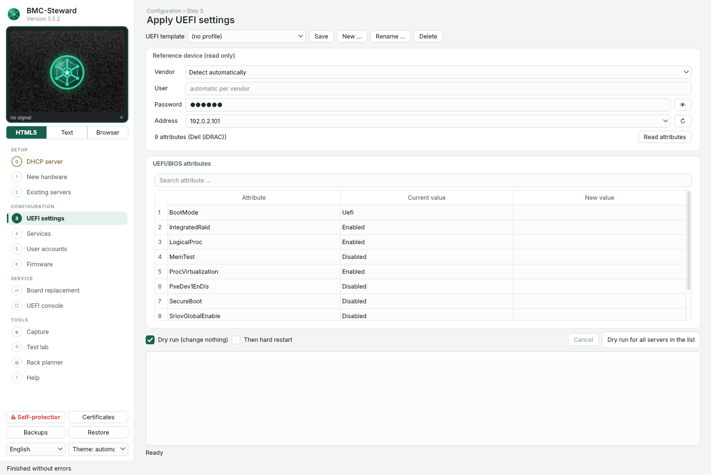
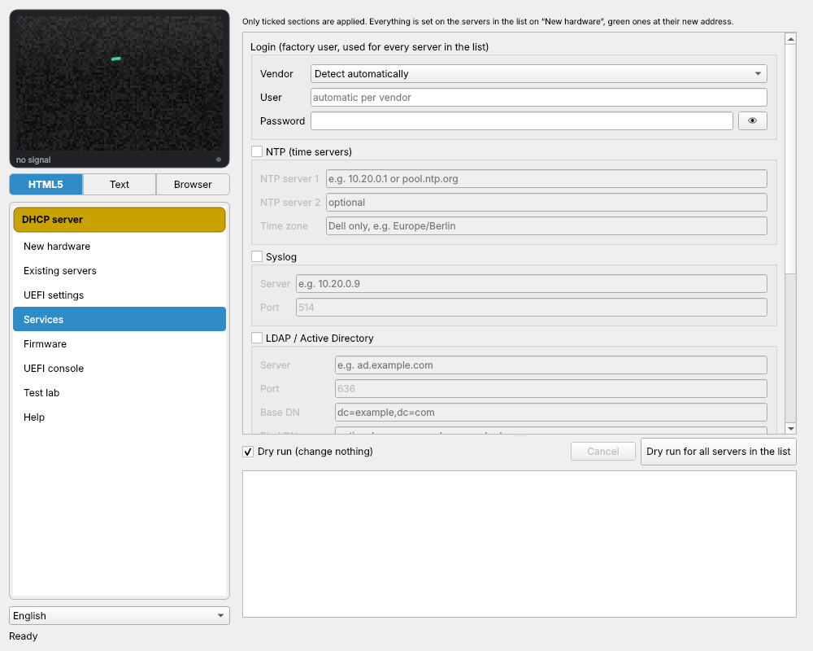
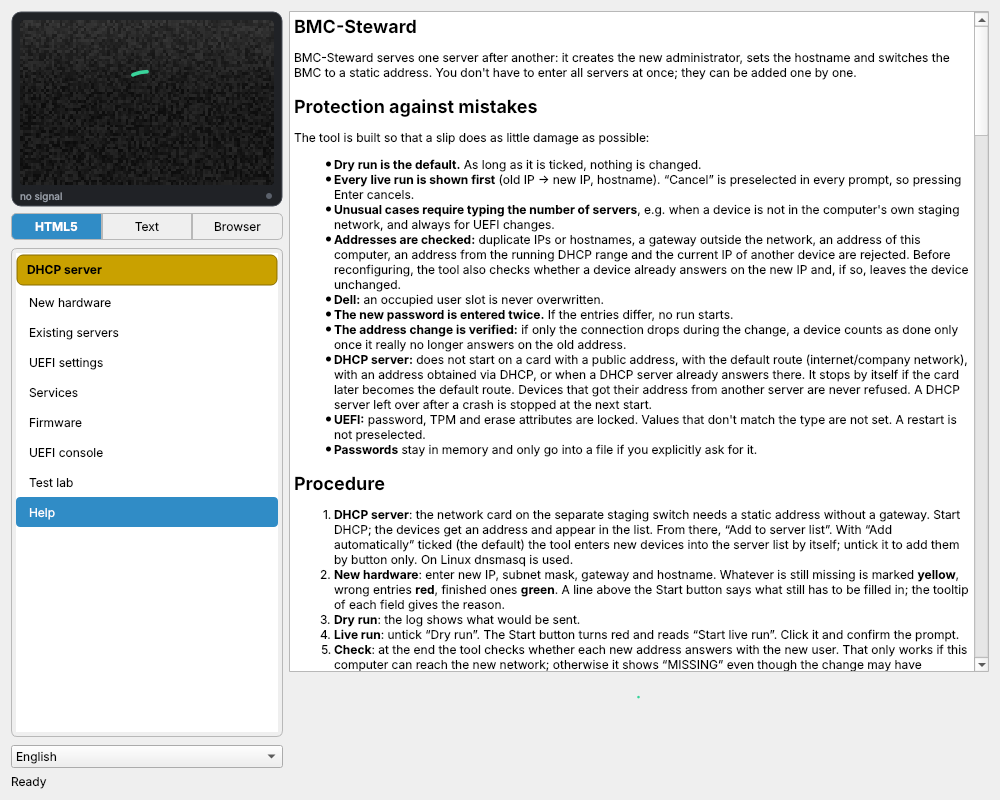
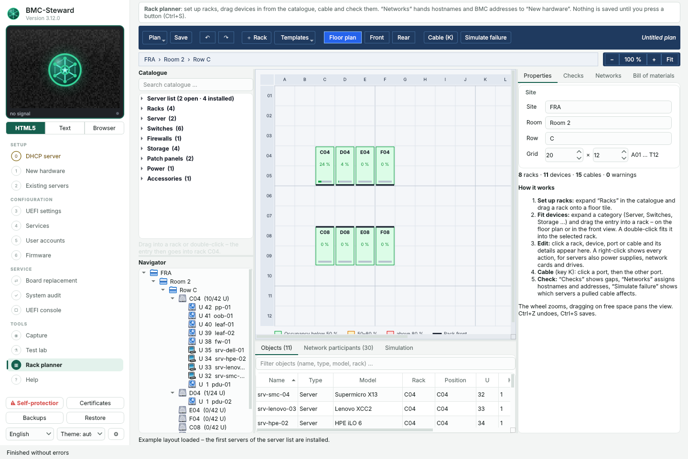

<h1>&nbsp;BMC-Steward</h1>

*Deutsche Fassung: [README.de.md](README.de.md)*

BMC-Steward is a small desktop tool for the first-time setup of server management controllers. It serves
one server after another: it creates a new administrator account, sets the hostname and switches the BMC
from its factory/DHCP address to a static one.

Supported: **Dell iDRAC**, **HPE iLO**, **Supermicro** and **Lenovo XCC** via Redfish. Older HPE servers
with **iLO 3 and iLO 4** are handled through the RIBCL XML interface, older Dell servers with
**iDRAC7/8** through Redfish (firmware 2.50.50.50 or newer).


<details>
<summary>Screenshots of all pages</summary>

| | |
|---|---|
| **DHCP server** | **New hardware** (above) |
|  | |
| **Existing servers** (connection test) | **UEFI settings** |
|  |  |
| **Services** | **UEFI console** |
|  |  |
| **Help** | **Rack planner** |
|  |  |

</details>

## What BMC-Steward does

The **menu** on the left has two parts: **Setup** lists the steps 0 to 6 in order (DHCP server, New hardware, Existing servers, UEFI settings, Services, User accounts, Firmware), **Tools** holds the UEFI console, Capture, Test lab, Rack planner and Help. Each setup page shows where you are (“Setup › Step 1”) and a clear title; the main action is the one green button. **DHCP server** is step 0 and lights up dark yellow under the mouse, because that is where you start.

**Design:** one consistent look for the whole program, dark and light. By default it follows the system's light/dark setting on Linux and Windows (and switches along when the system changes); the picker at the bottom of the menu fixes it to light or dark instead.

**Monitor at the top left:** while no console is connected it shows subtle black-and-white noise in which the logo – a sphere with a network – builds up every eight seconds, shows a star and glows green briefly and fades away again. Once connected, the server console appears there as a thumbnail; a click on it opens it full size right away. The switch below the monitor picks the console variant: **HTML5** (embedded), **Text** (SOL/SSH) or **Browser**. A hidden web view cannot be redrawn, so the monitor then keeps the last picture as a still frame. In the UEFI console, the **Full screen** button fills the whole screen (the text console enlarges its font to match); exit with “Exit full screen” in the bar at the top, because Esc and F11 belong to the server.

| Menu entry | What it does |
|---|---|
| **DHCP server** | Hands out addresses to fresh BMCs on a separate staging network so the tool can reach them at all. dnsmasq on Linux, built-in on Windows. Found devices move into the server list by themselves (“Add automatically”, on by default, can be switched off) or with one click. |
| **New hardware** | The core, for fresh servers: creates the new administrator, sets the hostname and switches the BMC to a static IP (address, subnet mask, gateway). Servers can be done one after another; finished rows turn green and are skipped on the next run. |
| **↳ Phone scanner** | Opens a camera-based input from “New hardware”: the phone (same network, or connected via USB tethering/hotspot) scans a barcode or text (OCR) off the device label, and the value goes straight into the password field. No photo is stored on the phone; the connection is encrypted over a secret link. |
| **Existing servers** | For BMCs that are already configured: a read-only connection test (port, encryption, vendor, login, model, firmware, admin rights). One login attempt per device so no account gets locked. Successful servers are handed over to “New hardware”, “UEFI settings” and “Services”. |
| **UEFI settings** | Reads the attributes that actually exist from a reference device and applies the values you choose across every server in the list. Password, TPM and erase attributes are locked. |
| **Services** | Sets up management services across vendors: NTP, syslog, LDAP/AD with group-to-role mapping, **hardening** (IPMI over LAN, SSDP, SNMP off; account lockout; session timeout) and – experimental – HTTPS certificate import. |
| **Firmware** | Firmware updates over the Redfish UpdateService: reads the firmware inventory of a reference device, then pushes a local file (multipart/HTTP push) or pulls one from a URL (SimpleUpdate) onto every server in the list, with live progress and verification. Dry run by default; live runs ask you to type the server count. |
| **UEFI console** | Shows a server's UEFI/BIOS through the BMC – as an embedded HTML5 console, a text console (SOL/SSH) or in the default browser. With a status bar, an **on-screen keyboard** (locking Ctrl/Alt/Shift, F keys, vendor setup/boot-menu keys, “Type text”), copy/paste, history, colour schemes, screenshots and automatic reconnect. |
| **↳ Find servers** | Finds BMCs whose address is unknown (“🔍 Search …” button in the UEFI console and “Find servers …” in “New hardware”): checks a range (e.g. `192.168.1.0/24`) for web interfaces, reads vendor, product and serial number there without logging in, and finds BMCs without a web interface via an IPMI ping. Read-only; no credentials are sent. |
| **Test lab** | Builds a cluster of virtual Dell/HPE/Lenovo/Supermicro BMCs (`tools/vbmc/`) – per server firmware generation, factory login, static factory IP or DHCP, model/serial, occupied Dell slot. Three networks: loopback (no root), **config room** (virtual staging switch, DHCP from “DHCP server”) and **router** (the servers join the real LAN and show up in the router). Scenarios can be saved and restored exactly. |
| **Rack planner** | Plans racks of any height: drag servers from the server list, switches, firewall, patch panel, PDU and placeholders into them, cable the ports (key K). Checks for BMCs without cable, missing redundancy and PDU load, assigns hostnames and BMC addresses and transfers them to “New hardware”, rebuilds the servers virtually in the test lab, shows the room as a floor plan with floor-tile coordinates (A … Z, AA, AB …), has a front and rear view per rack, simulates cable and switch failures and produces a bill of materials with estimated cable lengths and optics. **Connect to …** wires a port to any rack in one dialog, **Show path** follows a link through all patch panels end to end, every port carries SFP/transceiver, speed, MAC, IP, VLAN and a description (the cable type follows from the transceivers), and the **Network participants** list shows all used ports with filter and CSV export. Mouse-wheel zoom, right-click menus, undo/redo; catalogue with NetApp AFF, DS224C/DS460C shelves, ATTO FibreBridge, Brocade FC and cluster switches plus a “NetApp MetroCluster FC” template. Plans are saved as JSON. |
| **Help** | Explains every step and the per-vendor specifics, in the chosen language. |

On top of that:

- **Dry run** shows every call without changing anything (the default).
- **Profiles** remember recurring settings (never passwords, never the server list).
- **CSV import/export** of the server list, straight from an Excel export too.
- **Multilingual:** German, English, French, Swiss German (picker at the bottom left, below the menu).
- **Virtual test cluster** (`tools/vbmc/`): spin up fake BMCs of all four vendors – Redfish with a real address change, plus real SSH and IPMI-SOL for the console. Driven from the “Test lab” page or standalone from the command line.
- **Capture and compare** (page "Aufnahme"): reads the Redfish tree of a real device strictly read-only (the only exception is the session login) and saves it in DMTF mockup format – with serial numbers, addresses, host names, certificates and keys redacted, a capability report and a self-check that refuses to save if anything is left over. Two captures of the same device (e.g. before and after a firmware update) can be compared: lost write permissions, paths, actions and allowed values are reported as critical. Also available on the command line: `python3 -m bmc_steward.capture --help`.
- **Install hints per page:** if an optional package is missing on this machine (e.g. `paramiko` and `pyghmi` for the text console, `dnsmasq` for the DHCP server, `zbar`/`tesseract` for the phone scanner), the affected page shows a slim footer with the matching install command for the detected system (Arch, Debian/Ubuntu, Fedora, openSUSE, Windows), ready to copy.
- **Modular layout** (package `bmc_steward/`); developed on Linux, also runs from source on Windows (the ready-made .exe is archived and unmaintained).

## Built to forgive mistakes

- Dry run is the default; a live run shows what will happen and "Cancel" is preselected
- Missing entries are highlighted yellow, wrong ones red, finished ones green
- Duplicate or already used IP addresses are rejected before anything is changed
- An occupied Dell user slot is never overwritten
- The DHCP server refuses to start on anything that looks like a production network
  (default route, DHCP-assigned address, public address, another DHCP server answering)
- UEFI password, TPM and erase attributes are locked
- Passwords stay in memory unless you explicitly save them
- **Certificate trust:** each BMC's certificate is remembered on first contact; if the same device later shows a
  different one, it is blocked before any password is sent (button “Certificates …”)
- **Login via Redfish session:** the password crosses the wire once per device and the tool logs out at the end;
  a rejected login is never retried (the tool never locks an account)
- **Backup before every change** (JSON per device) and an **audit log** of all changing calls of live runs
  (button “Backups/logs”)
- **Factory account is locked:** after a successful check the tool logs in with the new administrator at the
  new address and locks the factory account (root, Administrator, ADMIN, USERID). If a BMC cannot disable
  accounts, it gets a random password that is stored nowhere. Can be switched off with “Lock factory account
  afterwards”
- **Firmware:** SHA-256 check against the vendor's value, the checked file is used for all servers; “Stop on
  error” is preselected
- **Self-protection:** UEFI changes, firmware updates and “Boot into UEFI setup” check the server's identity
  first. The machine running BMC-Steward and every server on the protection list (button “Self-protection”
  at the bottom left) are never restarted or flashed; if the identity cannot be read in a live run, the
  server is skipped

## Requirements

- Python 3.9 or newer
- PyQt6
- Linux only: `dnsmasq` and polkit (`pkexec`) for the DHCP server
- Optional, for the UEFI console: PyQt6-WebEngine (embedded console), `pyte` + `paramiko` + `pyghmi` (text console, Linux and Windows)

## Install and run

You need Python 3.9 or newer. The interface needs PyQt6; the DHCP server and the optional parts
(phone scanner, UEFI console) have their own helper programs.

### Arch Linux / CachyOS

```bash
# base install
sudo pacman -S python-pyqt6 dnsmasq git

# get the code and run
git clone https://github.com/daklicker-code/bmc-steward.git
cd bmc-steward
python bmc-steward.py
```

Optional components:

```bash
# phone scanner (barcode + OCR + QR code)
sudo pacman -S zbar tesseract tesseract-data-eng qrencode

# UEFI console: embedded web console and text console (SOL/SSH)
sudo pacman -S python-pyqt6-webengine
pip install --break-system-packages pyte paramiko pyghmi
```

With an active firewall (ufw), open UDP 67 for the DHCP server and port 8443 for the phone scanner:

```bash
sudo ufw allow 67/udp
sudo ufw allow 8443/tcp
```

### Windows

> **Note:** The ready-made Windows **.exe** and its build pipeline are **archived and no longer
> maintained** (see [`archive/windows-build/`](archive/windows-build/)). BMC-Steward still runs on
> Windows **from source** — the code is cross-platform — but is developed and tested on Linux.

**From source:**

1. **Install Python** from [python.org](https://www.python.org/downloads/) (3.9 or newer) and tick
   **“Add python.exe to PATH”** during setup.
2. **Install PyQt6** in a command prompt:
   ```powershell
   pip install PyQt6
   ```
3. **Get the code:** either with Git
   ```powershell
   git clone https://github.com/daklicker-code/bmc-steward.git
   ```
   or on GitHub via **Code → Download ZIP** and extract it.
4. **Run** from the project folder:
   ```powershell
   python bmc-steward.py
   ```

The DHCP server is built in on Windows (no dnsmasq needed) — allow the firewall prompt when you start
it. The phone scanner additionally needs `openssl`, `zbar`, `tesseract` and `qrencode` on the PATH,
installed by hand on Windows. The embedded UEFI console needs QtWebEngine and the text console
(SOL/SSH) needs `pyte`, `paramiko` and `pyghmi`; install them with
`pip install PyQt6-WebEngine pyte paramiko pyghmi`.

**Pinned installation (optional, recommended for production):** `requirements.lock` and
`requirements-optional.lock` pin every dependency to an exact version with SHA-256 hashes. Install with
`pip install --require-hashes -r requirements.lock` (add `-r requirements-optional.lock` for the
optional parts). The CI uses the same files; CodeQL, Dependabot and a CycloneDX SBOM per version tag
(workflow artifact) are set up under `.github/`.

### Debian / Ubuntu

```bash
sudo apt install python3-pyqt6 dnsmasq git
git clone https://github.com/daklicker-code/bmc-steward.git
cd bmc-steward
python3 bmc-steward.py
```

## How to use it

1. Connect your computer and the new servers' BMC ports to a **separate staging switch**. Give your
   network card a static address without a gateway, e.g. `192.168.0.1/24`.
2. “DHCP server”: start the DHCP server. The BMCs get an address and appear in the list. Add them to the server
   list.
3. “New hardware”: enter the factory login, the new administrator and, per server, the new IP, subnet mask,
   gateway and hostname.
4. Start a dry run and read the log.
5. Untick "Dry run", start the live run and confirm.

The built-in help (menu entry “Help”) explains every step and the differences between the vendors.

The **log** below the server list is the same for the whole program, test lab included. It fills as soon as the program starts and records the messages of the runs – never passwords, not even at “Debug” (a test drives real runs against virtual BMCs of every vendor and checks this). “Info” (default) shows what was done and the results; the UI chatter (buttons, ticks, selections, tabs, page changes) and the rack planner's room messages appear only at “Debug”, together with technical details. The **Log** button opens it as a text file in your default editor.

## CSV format

```
# current_ip,password,new_ip,subnet_mask,gateway,hostname,done
192.168.0.101,,10.20.0.11,255.255.255.0,10.20.0.1,srv-idrac-01,
```

The password column may be left out. Semicolons work too, so an Excel export can be loaded directly.

## Test status

| Vendor | Designed for | Status |
|---|---|---|
| Dell | iDRAC9 (14th to 16th generation) | first target platform (R6625) |
| Dell | iDRAC7/8 (12th/13th generation), firmware 2.50.50.50+ | tested against simulated BMCs only |
| HPE | iLO 5 and 6 | tested against simulated BMCs only |
| HPE | iLO 3 (G7) and iLO 4 (Gen8/Gen9), via RIBCL | tested against simulated BMCs only |
| Supermicro | X12/X13 | tested against simulated BMCs only |
| Lenovo | XCC2/XCC3 | tested against simulated BMCs only |

The UEFI settings, the management services (“Services”) and the Windows DHCP server have also only been
tested against simulations. Service coverage: NTP on all four vendors; syslog on Dell and HPE only
(skipped on Supermicro/Lenovo); LDAP with group mapping on all four; HTTPS certificate import is
experimental and vendor-specific (on HPE the key must come from a CSR generated on the iLO). Services
are not available for iLO 3/4.

Not supported: iDRAC6, iLO 2 and older, and iDRAC7/8 firmware before 2.50.50.50 (the tool detects it,
says so and changes nothing). iLO 3 only speaks TLS 1.0/1.1; the tool falls back to the old encryption
for such devices automatically and notes it in the log.
**Always try a single device first before a large rollout.**

## Running in a VM (VMware, Proxmox, Hyper-V)

- **Set up self-protection:** the VM does not know its host. Under “Self-protection”, enter every host the
  VM can run on (service tag/serial number, system UUID or BMC address). While the list is empty, the button
  shows a red warning and every confirmation prompt points it out.
- Preferably run the VM on a dedicated management host/cluster, not on the servers it manages. No vMotion,
  no memory snapshot and no suspend during firmware runs.
- Network: a dedicated vNIC (vmxnet3) in the staging/OOB port group, no NAT. The DHCP server and SSDP
  discovery need the same L2 segment as the BMCs. For brand-new BMCs with a static factory IP, add an extra
  address in that network.
- For virtual media the BMC fetches the file itself – it must be able to reach the VM.
- Time via NTP **or** VMware Tools time sync, not both.
- Saved lists with passwords end up in every VM backup: don't save them or encrypt the VM.

## Security notes

- Use the tool only in an isolated staging network.
- BMCs ship with self-signed certificates. Instead of checking against a CA, the tool therefore uses “trust on
  first use”: the SHA-256 fingerprint is stored per device, and a later change blocks the device before any
  password is sent. The very first contact is unprotected – so work only in an isolated staging network and,
  for existing servers, compare the fingerprint once with the BMC's web interface.
- If an unknown device with a different certificate answers at an address where another device is already
  pinned, it is blocked (otherwise an attacker could simply pose as a “new device”). Only “New hardware” merely
  warns, because factory and DHCP addresses repeat there with new devices. After swapping a device, remove the
  old entry under “Certificates”.
- The DHCP server and the test lab start programs from the tool folder via `pkexec` with root rights. Keep the
  tool folder writable only by your own user; to be fully safe, place it root-owned (e.g. under `/opt`) and start
  BMC-Steward from there.
- The phone scanner link carries a random 128-bit secret and is valid only while the scanner window is running.
- Working data (fingerprints `bmc-pins.json`, backups `sicherungen/`, audit log `protokolle/`) is stored next
  to the tool with permissions 0600/0700. The environment variable `BMC_STEWARD_DATA` selects another folder,
  e.g. an encrypted drive.
- A saved list contains passwords only if you choose so, and then in plain text. Delete such a file after
  the rollout.

## License

MIT, see [LICENSE](LICENSE). The software is provided without warranty; you use it at your own risk.

## Author

Björn Franzke
