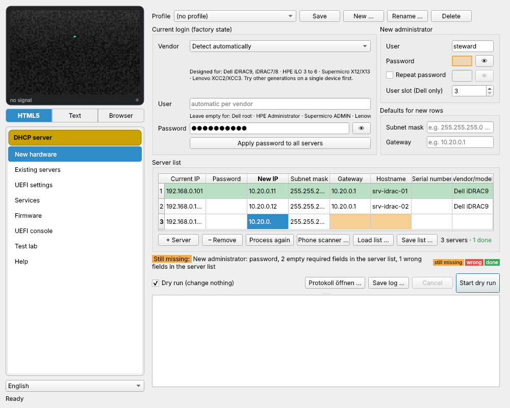
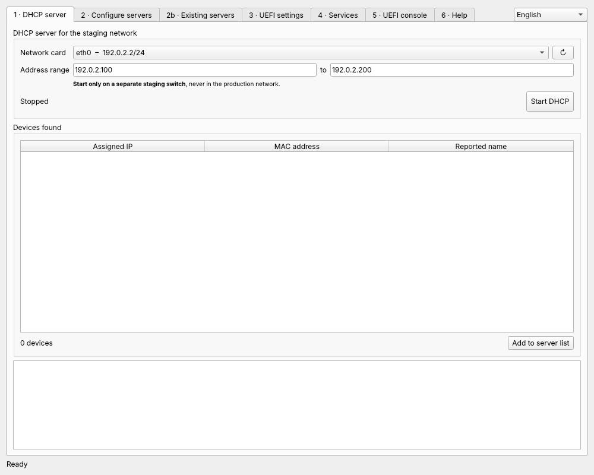

<h1>&nbsp;BMC-Steward</h1>

*Deutsche Fassung: [README.de.md](README.de.md)*

BMC-Steward is a small desktop tool for the first-time setup of server management controllers. It serves
one server after another: it creates a new administrator account, sets the hostname and switches the BMC
from its factory/DHCP address to a static one.

Supported: **Dell iDRAC**, **HPE iLO**, **Supermicro** and **Lenovo XCC** via Redfish. Older HPE servers
with **iLO 3 and iLO 4** are handled through the RIBCL XML interface, older Dell servers with
**iDRAC7/8** through Redfish (firmware 2.50.50.50 or newer).



<details>
<summary>Screenshots of all pages</summary>

| | |
|---|---|
| **DHCP server** | **New hardware** (above) |
|  | |
| **Existing servers** (connection test) | **UEFI settings** |
|  |  |
| **Services** | **UEFI console** |
|  |  |
| **Help** | |
|  | |

</details>

## What BMC-Steward does

Since version 3.0 the tab bar is replaced by a **menu** on the left; the selected page opens next to it. Work through the entries in order or use only what you need. **DHCP server** sits at the top as a dark-yellow button, because that is where you start.

**Monitor at the top left:** while no console is connected it shows subtle black-and-white noise in which the logo – a sphere with a network – builds up every eight seconds, shows a star and glows green briefly and fades away again. Once connected, the server console appears there as a thumbnail; a click on it opens it full size right away. The switch below the monitor picks the console variant: **HTML5** (embedded), **Text** (SOL/SSH) or **Browser**. A hidden web view cannot be redrawn, so the monitor then keeps the last picture as a still frame.

| Menu entry | What it does |
|---|---|
| **DHCP server** | Hands out addresses to fresh BMCs on a separate staging network so the tool can reach them at all. dnsmasq on Linux, built-in on Windows. Found devices move into the server list by themselves (“Add automatically”, on by default, can be switched off) or with one click. |
| **New hardware** | The core, for fresh servers: creates the new administrator, sets the hostname and switches the BMC to a static IP (address, subnet mask, gateway). Servers can be done one after another; finished rows turn green and are skipped on the next run. |
| **↳ Phone scanner** | Opens a camera-based input from “New hardware”: the phone (same network, or connected via USB tethering/hotspot) scans a barcode or text (OCR) off the device label, and the value goes straight into the password field. No photo is stored on the phone; the connection is encrypted over a secret link. |
| **Existing servers** | For BMCs that are already configured: a read-only connection test (port, encryption, vendor, login, model, firmware, admin rights). One login attempt per device so no account gets locked. Successful servers are handed over to “New hardware”, “UEFI settings” and “Services”. |
| **UEFI settings** | Reads the attributes that actually exist from a reference device and applies the values you choose across every server in the list. Password, TPM and erase attributes are locked. |
| **Services** | Sets up management services across vendors: NTP, syslog, LDAP/AD with group-to-role mapping and – experimental – HTTPS certificate import. |
| **Firmware** | Firmware updates over the Redfish UpdateService: reads the firmware inventory of a reference device, then pushes a local file (multipart/HTTP push) or pulls one from a URL (SimpleUpdate) onto every server in the list, with live progress and verification. Dry run by default; live runs ask you to type the server count. |
| **UEFI console** | Shows a server's UEFI/BIOS through the BMC – as an embedded HTML5 console, a text console (SOL/SSH) or in the default browser. |
| **Test lab** | Builds a cluster of virtual Dell/HPE/Lenovo/Supermicro BMCs (`tools/vbmc/`) – per server firmware generation, factory login, static factory IP or DHCP, model/serial, occupied Dell slot. Three networks: loopback (no root), **config room** (virtual staging switch, DHCP from “DHCP server”) and **router** (the servers join the real LAN and show up in the router). Scenarios can be saved and restored exactly. |
| **Help** | Explains every step and the per-vendor specifics, in the chosen language. |

On top of that:

- **Dry run** shows every call without changing anything (the default).
- **Profiles** remember recurring settings (never passwords, never the server list).
- **CSV import/export** of the server list, straight from an Excel export too.
- **Multilingual:** German, English, French, Swiss German (picker at the bottom left, below the menu).
- **Virtual test cluster** (`tools/vbmc/`): spin up fake BMCs of all four vendors – Redfish with a real address change, plus real SSH and IPMI-SOL for the console. Driven from the “Test lab” page or standalone from the command line.
- **Modular layout** (package `bmc_steward/`); developed on Linux, also runs from source on Windows (the ready-made .exe is archived and unmaintained).

## Built to forgive mistakes

- Dry run is the default; a live run shows what will happen and "Cancel" is preselected
- Missing entries are highlighted yellow, wrong ones red, finished ones green
- Duplicate or already used IP addresses are rejected before anything is changed
- An occupied Dell user slot is never overwritten
- The DHCP server refuses to start on anything that looks like a production network
  (default route, DHCP-assigned address, public address, another DHCP server answering)
- UEFI password, TPM and erase attributes are locked
- Passwords stay in memory unless you explicitly save them

## Requirements

- Python 3.9 or newer
- PyQt6
- Linux only: `dnsmasq` and polkit (`pkexec`) for the DHCP server
- Optional, for the UEFI console: PyQt6-WebEngine (embedded console), `pyte` + `paramiko` + `pyghmi` (text console, Linux and Windows)

## Install and run

You need Python 3.9 or newer. The interface needs PyQt6; the DHCP server and the optional parts
(phone scanner, UEFI console) have their own helper programs.

### Arch Linux / CachyOS

```bash
# base install
sudo pacman -S python-pyqt6 dnsmasq git

# get the code and run
git clone https://github.com/daklicker-code/bmc-steward.git
cd bmc-steward
python bmc-steward.py
```

Optional components:

```bash
# phone scanner (barcode + OCR + QR code)
sudo pacman -S zbar tesseract tesseract-data-eng qrencode

# UEFI console: embedded web console and text console (SOL/SSH)
sudo pacman -S python-pyqt6-webengine
pip install --break-system-packages pyte paramiko pyghmi
```

With an active firewall (ufw), open UDP 67 for the DHCP server and port 8443 for the phone scanner:

```bash
sudo ufw allow 67/udp
sudo ufw allow 8443/tcp
```

### Windows

> **Note:** The ready-made Windows **.exe** and its build pipeline are **archived and no longer
> maintained** (see [`archive/windows-build/`](archive/windows-build/)). BMC-Steward still runs on
> Windows **from source** — the code is cross-platform — but is developed and tested on Linux.

**From source:**

1. **Install Python** from [python.org](https://www.python.org/downloads/) (3.9 or newer) and tick
   **“Add python.exe to PATH”** during setup.
2. **Install PyQt6** in a command prompt:
   ```powershell
   pip install PyQt6
   ```
3. **Get the code:** either with Git
   ```powershell
   git clone https://github.com/daklicker-code/bmc-steward.git
   ```
   or on GitHub via **Code → Download ZIP** and extract it.
4. **Run** from the project folder:
   ```powershell
   python bmc-steward.py
   ```

The DHCP server is built in on Windows (no dnsmasq needed) — allow the firewall prompt when you start
it. The phone scanner additionally needs `openssl`, `zbar`, `tesseract` and `qrencode` on the PATH,
installed by hand on Windows. The embedded UEFI console needs QtWebEngine and the text console
(SOL/SSH) needs `pyte`, `paramiko` and `pyghmi`; install them with
`pip install PyQt6-WebEngine pyte paramiko pyghmi`.

### Debian / Ubuntu

```bash
sudo apt install python3-pyqt6 dnsmasq git
git clone https://github.com/daklicker-code/bmc-steward.git
cd bmc-steward
python3 bmc-steward.py
```

## How to use it

1. Connect your computer and the new servers' BMC ports to a **separate staging switch**. Give your
   network card a static address without a gateway, e.g. `192.168.0.1/24`.
2. “DHCP server”: start the DHCP server. The BMCs get an address and appear in the list. Add them to the server
   list.
3. “New hardware”: enter the factory login, the new administrator and, per server, the new IP, subnet mask,
   gateway and hostname.
4. Start a dry run and read the log.
5. Untick "Dry run", start the live run and confirm.

The built-in help (menu entry “Help”) explains every step and the differences between the vendors.

## CSV format

```
# current_ip,password,new_ip,subnet_mask,gateway,hostname,done
192.168.0.101,,10.20.0.11,255.255.255.0,10.20.0.1,srv-idrac-01,
```

The password column may be left out. Semicolons work too, so an Excel export can be loaded directly.

## Test status

| Vendor | Designed for | Status |
|---|---|---|
| Dell | iDRAC9 (14th to 16th generation) | first target platform (R6625) |
| Dell | iDRAC7/8 (12th/13th generation), firmware 2.50.50.50+ | tested against simulated BMCs only |
| HPE | iLO 5 and 6 | tested against simulated BMCs only |
| HPE | iLO 3 (G7) and iLO 4 (Gen8/Gen9), via RIBCL | tested against simulated BMCs only |
| Supermicro | X12/X13 | tested against simulated BMCs only |
| Lenovo | XCC2/XCC3 | tested against simulated BMCs only |

The UEFI settings, the management services (“Services”) and the Windows DHCP server have also only been
tested against simulations. Service coverage: NTP on all four vendors; syslog on Dell and HPE only
(skipped on Supermicro/Lenovo); LDAP with group mapping on all four; HTTPS certificate import is
experimental and vendor-specific (on HPE the key must come from a CSR generated on the iLO). Services
are not available for iLO 3/4.

Not supported: iDRAC6, iLO 2 and older, and iDRAC7/8 firmware before 2.50.50.50 (the tool detects it,
says so and changes nothing). iLO 3 only speaks TLS 1.0/1.1; the tool falls back to the old encryption
for such devices automatically and notes it in the log.
**Always try a single device first before a large rollout.**

## Security notes

- Use the tool only in an isolated staging network.
- BMCs ship with self-signed certificates, so TLS certificates are not verified.
- A saved list contains passwords only if you choose so, and then in plain text. Delete such a file after
  the rollout.

## License

MIT, see [LICENSE](LICENSE). The software is provided without warranty; you use it at your own risk.

## Author

Björn Franzke
